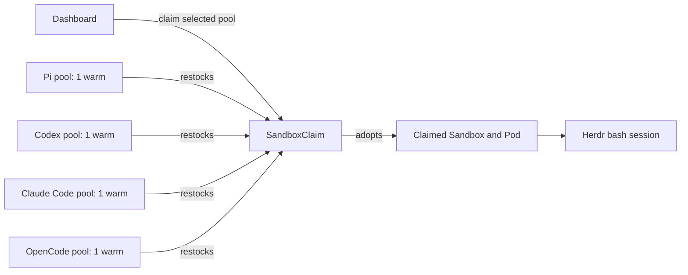

# Nightshift architecture

Nightshift combines a Kubernetes sandbox fleet with a terminal dashboard and
GitHub views. The automated ticket-to-merge workflow is still on the roadmap.
The demo runs in `sandbox-demo` on `kind-agent-sandbox`.

## Sandbox fleet

The agent-sandbox controller reconciles four resource types: a
`SandboxTemplate` defines each pod, a `SandboxWarmPool` keeps standbys ready,
a `SandboxClaim` requests a workspace from one pool, and a `Sandbox` owns the
resulting pod. Nightshift does not create or delete pods directly.

`demo/warmpool.yaml` defines four templates and pools, each with one standby:

| Agent | Pool | Template | Image |
| --- | --- | --- | --- |
| Pi | `pi-pool` | `pi-template` | `ghcr.io/tmih06/nightshift-pi:latest` |
| Codex | `codex-pool` | `codex-template` | `ghcr.io/tmih06/nightshift-codex:latest` |
| Claude Code | `claude-code-pool` | `claude-code-template` | `ghcr.io/tmih06/nightshift-claude-code:latest` |
| OpenCode | `opencode-pool` | `opencode-template` | `ghcr.io/tmih06/nightshift-opencode:latest` |

Every pod requests 100m CPU and is
limited to 500m. OpenCode requests 512Mi memory and is limited to 2Gi; the
others request 128Mi and are limited to 256Mi. Images use `Always` with mutable
`latest` tags; existing pods do not update just because a tag changes. See
`images/agent/README.md` for image publishing, registry access, reproducibility,
and the limits of this budget.

## Claim cycle

Select a warm sandbox in the dashboard and press `c` to claim its pool. When
no warm sandbox is selected, `c` defaults to Pi. Alternatively, `sbx` defaults
to Pi and accepts `POOL=codex-pool`, `POOL=claude-code-pool`, or
`POOL=opencode-pool`; `demo/claim.yaml` is a Pi example. A claim adopts any
available sandbox in the chosen pool, not necessarily the exact selected pod.
The controller replenishes that pool. Deleting a claim destroys its sandbox
and pod because its shutdown policy is `Delete`.

Inside a claimed pod, Herdr keeps bash alive independently of the dashboard's
connection. The dashboard reads and interacts with it through `kubectl exec`;
see `docs/session-manager.md`. Pod deletion or restart ends the session and
its ephemeral workspace. Credentials must be supplied at runtime.

## Operating the demo

Apply `demo/warmpool.yaml` after installing the agent-sandbox controller and
ensuring the GHCR images are accessible. This creates `pi-pool` but does not
remove the old `agent-pool` or the `agent-bash-template` template. Existing
claims may still reference the old resources; do not delete them as part of
migration. Review and remove old resources separately after obtaining permission. Applying the
manifest does not remove unrelated resources or stale pools.

Use k9s or kubectl to inspect `SandboxTemplate` (`sbt`), `SandboxWarmPool`
(`swp`), `SandboxClaim` (`sbc`), `Sandbox` (`sbx`), and pod resources in
`sandbox-demo`. The default claim loop is `SBX_NO_EXEC=1 sbx`, which removes
only the claim it creates. See `CONTEXT.md` for dashboard and verify commands.

For multi-node clusters, image access and scheduling apply to every node. The
template's PodSpec can use affinity, topology spread, or runtime classes;
network storage is needed if state must outlive a pod. Warm-pool refill and
controller concurrency may need tuning at larger scale.
