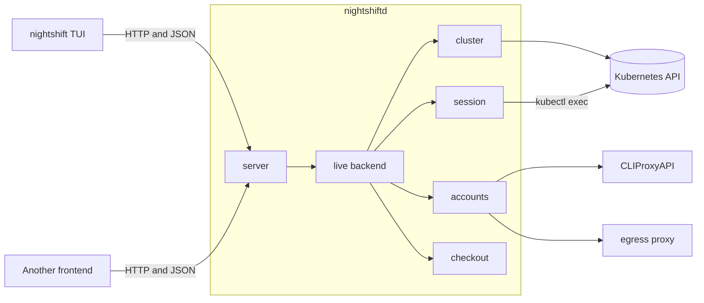
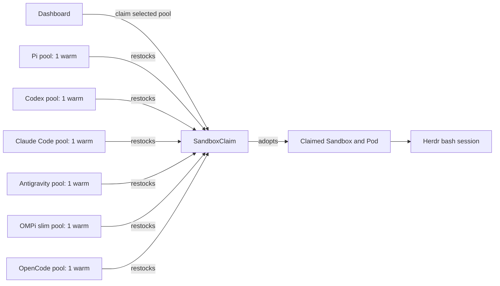
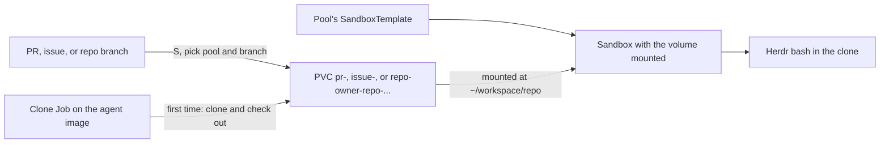
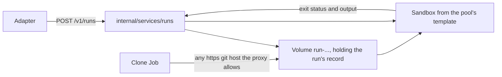

# Nightshift architecture

Nightshift combines a Kubernetes sandbox fleet with a terminal dashboard and
GitHub views. The automated ticket-to-merge workflow is still on the roadmap.
Nightshift runs in the `nightshift` namespace of any Kubernetes cluster, on
`kind-agent-sandbox` by default.

## Two programs

Nightshift is **nightshift-services** and any number of frontends, with one
contract between them. The services own everything that touches Kubernetes.
A frontend, such as the terminal UI, draws screens and turns keys into API
calls; it holds no kubeconfig and runs no `kubectl`. `docs/api.md` has the
contract's rules, and `api/openapi.yaml` is the contract itself.



```text
api/            the contract: openapi.yaml, v1 (types), client (Go SDK)
cmd/nightshiftd the services as a daemon
cmd/nightshift  the terminal UI: a client, it runs nothing else
internal/services/{cluster,session,accounts,checkout,runs,server,live,daemon,egress}
internal/tui/{app,dashboard,accountsview,repoview,dialog,fleet}
```

Everything runs in the cluster, each part in its own pod: the services
(`nightshiftd`), the egress proxy, CLIProxyAPI, the credential refresher, and
the sandboxes. The laptop runs only the terminal. `nightshiftd` acts through a service account with `NIGHTSHIFT_CONTEXT=-` and reach
CLIProxyAPI and the egress proxy by their Service addresses. In the cluster,
many people on many machines use one address and nobody needs a kubeconfig. The
manifests assume no provider, the setup script builds and loads an image on kind
and pulls one anywhere else, and the services' permissions are pinned by
`TestTheServicesHaveLeastPrivilege`. One server serves one cluster; a frontend
can talk to several servers. Run one replica per cluster: what a server keeps in
memory, the progress of running checkouts and its connections into sandboxes, is
rebuilt from the cluster after a restart.

Two things keep the halves apart. The terminal UI imports only `api/v1` and
`api/client`, which `internal/architecture_test.go` enforces in both directions,
and the HTTP layer imports nothing of the cluster, so the contract is the only
thing they share.

## Sandbox fleet

The agent-sandbox controller reconciles four resource types: a
`SandboxTemplate` defines each pod, a `SandboxWarmPool` keeps standbys ready,
a `SandboxClaim` requests a workspace from one pool, and a `Sandbox` owns the
resulting pod. Nightshift does not create or delete pods directly; for pull
request volumes it creates a Sandbox and a clone Job, whose controllers make
the pods.



`k8s/warmpool.yaml` defines six templates and pools, each with one standby:

| Agent | Pool | Template | Image |
| --- | --- | --- | --- |
| Pi | `pi-pool` | `pi-template` | `ghcr.io/tmih06/nightshift-pi:latest` |
| Codex | `codex-pool` | `codex-template` | `ghcr.io/tmih06/nightshift-codex:latest` |
| Claude Code | `claude-code-pool` | `claude-code-template` | `ghcr.io/tmih06/nightshift-claude-code:latest` |
| Antigravity | `agy-pool` | `agy-template` | `ghcr.io/tmih06/nightshift-agy:latest` |
| OMPi slim | `ompig-slim-pool` | `ompig-slim-template` | `ghcr.io/tmih06/nightshift-ompig-slim:latest` |
| OpenCode | `opencode-pool` | `opencode-template` | `ghcr.io/tmih06/nightshift-opencode:latest` |

Every pod requests 100m CPU and is
limited to 1000m CPU and 2Gi memory; OpenCode requests 512Mi memory and the
others request 128Mi. Images use `Always` with mutable
`latest` tags; existing pods do not update just because a tag changes. See
`images/agent/README.md` for image publishing, registry access, reproducibility,
and the limits of this budget.

## Claim cycle

Select a warm sandbox in the dashboard and press `c` to claim its pool. When
no warm sandbox is selected, `c` defaults to Pi. Alternatively, `sbx` defaults
to Pi and accepts `POOL=codex-pool`, `POOL=claude-code-pool`, `POOL=agy-pool`,
`POOL=ompig-slim-pool`, or `POOL=opencode-pool`; `k8s/claim.yaml` is a Pi
example. A claim adopts any available sandbox in the chosen pool, not
necessarily the exact selected pod.
The controller replenishes that pool. Deleting a claim destroys its sandbox
and pod because its shutdown policy is `Delete`.

## Pull request, issue, and repository volumes

`S` on a pull request, issue, or repository/branch in the GitHub tab gives it a
volume that outlives any sandbox. gh-dash or the Repo view sends the target to
the root model, which asks for a pool (and a branch name for an issue or
repository), forks a right-side model submenu for that pool's harness, and
hands the checkout—along with the chosen harness and model—to the sandbox tab.



A claim cannot do this. A warm pod is already running, and a pod's volumes
are fixed at creation. A claim's `volumeClaimTemplates` force a cold start,
and the controller makes those PVCs owned by the sandbox, so they would be
deleted with it. Nightshift therefore creates and owns the PersistentVolumeClaim
itself, labelled `nightshift.dev/volume`. A Job on the pool's image clones
into the volume's `repo` directory as the sandbox's user. The volume's root
belongs to root, where git refuses to work for that user. The volume is then
annotated as cloned and the Job is deleted. Nightshift then creates a `Sandbox` directly from
the pool's template, with that directory mounted as a subPath. The warm pool
does not count it, as it carries no pool label.

The clone script turns git's carriage-return progress into lines,
unbuffered, so the dashboard can follow it from the Job's log while the clone
runs. The whole checkout runs as one background step that reports each
stage to the sandbox tab.

Destroying that sandbox asks whether the volume goes too. Keeping it deletes
the Sandbox and its pod only. Volumes are named `pr-<owner>-<repo>-<n>`,
`issue-<owner>-<repo>-<n>`, or `repo-<owner>-<repo>-<branch>` (truncated and
hashed when longer than 63 characters). Picking the same pull request, issue,
or repository branch again mounts the kept volume without cloning (switching to
the requested branch for an issue or repository), or returns to the sandbox
already on it.
Dropping it also deletes the PersistentVolumeClaim, which Kubernetes removes
once the pod is gone. A clone that did not finish is redone from
scratch. The cluster's `standard` class is local-path, so a volume lives on
one node's disk and pins its sandboxes to that node.

Inside a claimed pod, Herdr keeps bash alive independently of the dashboard's
connection. The services read and interact with it through `kubectl exec`, and
frontends through the terminal endpoints of the API; see
`docs/session-manager.md`. Pod deletion or restart ends the session and
its ephemeral workspace. Credentials must be supplied at runtime, or isolated
outside the sandbox via Nightshift's optional lightweight Go egress proxy
(`cmd/egress-proxy`, `k8s/egress.yaml`, `k8s/egress-setup.sh`): a single
pod in `nightshift-egress` holds real API/GitHub credentials, enforces
default-deny host/method/path allowlists and SSRF-safe dialing, swaps opaque
`nightshift:secret:*` env placeholders on matched hosts only, and scrubs
reflected secrets from responses while `NetworkPolicy` blocks direct internet
and DNS from checkout sandboxes.

Interactive OAuth logins also fit the proxy model, because an OAuth access
token is just a bearer string. Claude Code, Codex, and Antigravity (`agy`)
log in once on a master and every sandbox then boots logged in, yet no real
credential ever exists inside a sandbox. `k8s/creds-stage.sh` rewrites each
login file: the access token becomes a placeholder
(`nightshift:secret:CLAUDE_ACCESS_TOKEN`, `CODEX_ACCESS_TOKEN`, or
`AGY_ACCESS_TOKEN`), the expiry moves far into the future so the agent never
tries to refresh, and the refresh token is dropped (Codex insists on one, so
it gets an inert string). `gh`'s `hosts.yml` gets the `GITHUB_TOKEN`
placeholder. A login with no swap is never distributed. The proxy swaps each
placeholder for the real token on that agent's hosts: `api.anthropic.com`,
`chatgpt.com`, and `cloudcode-pa.googleapis.com` (plus Antigravity's token
check under `www.googleapis.com/oauth2/`). The `sandbox-egress-env`
ConfigMap sets `CLAUDE_CODE_OAUTH_TOKEN` and never `ANTHROPIC_API_KEY`,
which Claude Code gives precedence over every OAuth path.

Which agents get this treatment is data, not code: `k8s/creds-providers.json`
lists, per agent, its login file, where the access token sits in it, how to
swap it, the API hosts that must honor the placeholder, its warm pool, and the
command that makes it refresh. `creds-stage.sh`, `creds-publish.sh`, and the
pool sizing all read it, and `TestShippedPolicySwapsEveryRegisteredLogin`
fails when an entry has no matching proxy rule. Adding an agent is one entry
plus its proxy rule.

Where the master logins come from is the one choice to make. Signing in needs a
person with a browser, and the tokens then expire and rotate, so exactly one
process must hold the refresh tokens:

- **CLIProxyAPI (`k8s/cpa.yaml`)** is the login surface. You open its page
  once per account (`docs/login-surface.md` explains the choice), and it keeps
  the tokens fresh. The `creds-refresher` pod (`k8s/creds.yaml`, image
  `images/creds`) runs `creds-publish.sh --cpa` every five minutes: it lists
  the accounts over CLIProxyAPI's management API, rebuilds each agent's login
  file from them (the `cpa` entries of `creds-providers.json`), and publishes
  as below. Install both with `k8s/creds-setup.sh`. Nothing depends on a
  laptop staying online.
- **A laptop** also works: log in with `claude`, `codex`, and `agy`, then run
  `creds-publish.sh --watch 1200`, which exercises each CLI to refresh it.
  Do not run both for the same agent: each would overwrite the other's secrets.

Publishing is the same either way. The placeholder copies go into the
`agent-creds` secret that templates untar into `$HOME` at boot, the real
access tokens into `egress-secrets`, and a warm sandbox is kept only for
agents that have a login. The proxy binds those secrets to files on a mounted
volume and re-reads them every 15 seconds (`internal/services/egress/reload.go`), so a
refreshed token needs no restart; the kubelet takes up to about two minutes to
update the volume. The refresher's service account may only edit the two
credential secrets and the warm pool sizes
(`TestCredsRefresherHasLeastPrivilege`), and CLIProxyAPI's network policy
admits only the refresher.

The **Accounts tab** (`internal/tui/accountsview`, over `internal/services/accounts`
and the `/v1/accounts` endpoints) is how people drive all of this from the TUI.
The services reach CLIProxyAPI's management API through a `kubectl port-forward`
that they own and restart, and the egress proxy's admin port through another;
in the cluster they use the Services' addresses instead, so on a laptop nothing
is needed but the kubeconfig Nightshift already uses. It lists every signed-in account per agent, runs the
sign-in (the link, then the pasted callback address), disables, removes, and
refreshes accounts, and publishes on demand. Several accounts per agent are
supported by choice, not by splitting traffic: the account picked with enter is
recorded in the `nightshift-accounts` ConfigMap, `creds-publish.sh` publishes
that one (or the first enabled one if it is gone), and only the sandboxes
started afterwards get it. Usage comes from the proxy: it tags every request
that carried a token with the account label published beside it
(`LABEL_<secret>`), counts them in ten-minute windows, and serves the counts
at `/usage` on its admin port, so a switch of account splits the history
correctly. The counts live in the proxy's memory and start over when it
restarts.

One login can serve several clusters: `PUBLISH_CONTEXTS` lists the contexts to
publish into (`-` is the cluster the refresher runs in), and
`REMOTE_KUBECONFIG` points at a mounted kubeconfig for the others. Every
cluster receives the same placeholders and tokens, so no cluster refreshes
anything and no refresh token is ever held twice.

Nothing here is specific to kind. `NIGHTSHIFT_CONTEXT` selects the kubeconfig
context for the scripts and the TUI, the manifests pin no service address, and
`egress-setup.sh` pulls the published proxy image on any cluster that is not
kind (`EGRESS_IMAGE` points it at your own registry, `EGRESS_BUILD=1` builds
and pushes one). The cluster needs a default StorageClass for the refresher's
volume and a network plugin that enforces `NetworkPolicy`. Secrets live in
ordinary Kubernetes Secrets, so an external secret manager that syncs into
them (External Secrets, a CSI driver) slots in without changing the proxy.

Two cluster facts shape the wiring. Sandbox pods use external DNS resolvers
(`8.8.8.8`, `1.1.1.1`, set by the agent-sandbox controller), so cluster
service names never resolve for them: `egress-setup.sh` reads the proxy
Service's assigned `clusterIP` and patches it into `sandbox-egress-env`, which
the manifest therefore leaves unset (a plain `kubectl apply` must not reset it).
And the agent-sandbox controller generates a NetworkPolicy per template allowing
egress to the public internet but denying all private ranges, which includes
the proxy's ClusterIP; `sandbox-egress-proxy-access` additively re-opens the
proxy path for sandbox pods only (network policies are union-permissive, so no
rule of the controller's needs changing). It must not select every pod: an
empty selector would isolate the refresher too. Note the corollary: warm pool
pods retain direct internet access — credential safety rests on placeholders
being worthless off the proxy path, not on network restriction. Tightening
templates to proxy-only egress is possible through the template
`networkPolicy` field but will break any tool the proxy rules do not cover.

## Runs

A run is a task given to a coding agent through `/v1/runs`. It is how work from
outside, such as an issue tracker's tickets, reaches the fleet: an adapter per
tracker calls the API, and the services never learn which tracker it is.



It reuses the checkout's clone Job and volume sandbox. The agent runs in its
non-interactive mode from a script that `hc run` starts in a new terminal, so it
shows in the Pods tab like any other, and the services keep no connection to the
sandbox open. The script leaves the exit status in a file,
which the services poll with `kubectl exec`. The run's record is an annotation
on its volume, so a restarted server finds it again and needs no new
permission. See `docs/api.md` for the contract and its limits.

## Operating the cluster

Apply `k8s/warmpool.yaml` after installing the agent-sandbox controller and
ensuring the GHCR images are accessible. This creates `pi-pool` but does not
remove the old `agent-pool` or the `agent-bash-template` template. Existing
claims may still reference the old resources; do not delete them as part of
migration. Review and remove old resources separately after obtaining permission. Applying the
manifest does not remove unrelated resources or stale pools.

Use k9s or kubectl to inspect `SandboxTemplate` (`sbt`), `SandboxWarmPool`
(`swp`), `SandboxClaim` (`sbc`), `Sandbox` (`sbx`), and pod resources in
`nightshift`. Pull request volumes stay until removed by hand:
`kubectl delete pvc -l nightshift.dev/volume` removes all of them, once no
sandbox mounts them. The default claim loop is `SBX_NO_EXEC=1 sbx`, which removes
only the claim it creates. See `CONTEXT.md` for dashboard and verify commands.

For multi-node clusters, image access and scheduling apply to every node. The
template's PodSpec can use affinity, topology spread, or runtime classes;
network storage is needed if state must outlive a pod. Warm-pool refill and
controller concurrency may need tuning at larger scale.
