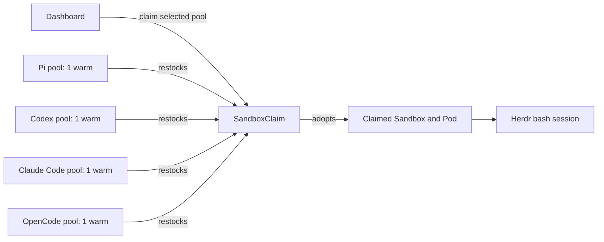
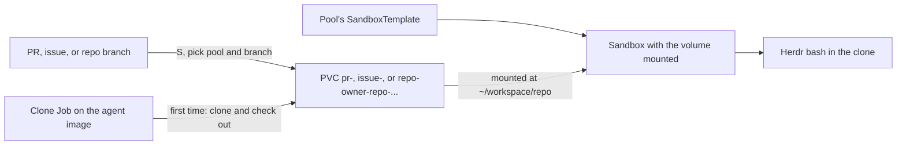

# Nightshift architecture

Nightshift combines a Kubernetes sandbox fleet with a terminal dashboard and
GitHub views. The automated ticket-to-merge workflow is still on the roadmap.
Nightshift runs in the `nightshift` namespace on `kind-agent-sandbox`.

## Sandbox fleet

The agent-sandbox controller reconciles four resource types: a
`SandboxTemplate` defines each pod, a `SandboxWarmPool` keeps standbys ready,
a `SandboxClaim` requests a workspace from one pool, and a `Sandbox` owns the
resulting pod. Nightshift does not create or delete pods directly; for pull
request volumes it creates a Sandbox and a clone Job, whose controllers make
the pods.

`k8s/warmpool.yaml` defines four templates and pools, each with one standby:

| Agent | Pool | Template | Image |
| --- | --- | --- | --- |
| Pi | `pi-pool` | `pi-template` | `ghcr.io/tmih06/nightshift-pi:latest` |
| Codex | `codex-pool` | `codex-template` | `ghcr.io/tmih06/nightshift-codex:latest` |
| Claude Code | `claude-code-pool` | `claude-code-template` | `ghcr.io/tmih06/nightshift-claude-code:latest` |
| OpenCode | `opencode-pool` | `opencode-template` | `ghcr.io/tmih06/nightshift-opencode:latest` |

Every pod requests 100m CPU and is
limited to 1000m CPU and 2Gi memory; OpenCode requests 512Mi memory and the
others request 128Mi. Images use `Always` with mutable
`latest` tags; existing pods do not update just because a tag changes. See
`images/agent/README.md` for image publishing, registry access, reproducibility,
and the limits of this budget.

## Claim cycle

Select a warm sandbox in the dashboard and press `c` to claim its pool. When
no warm sandbox is selected, `c` defaults to Pi. Alternatively, `sbx` defaults
to Pi and accepts `POOL=codex-pool`, `POOL=claude-code-pool`, or
`POOL=opencode-pool`; `k8s/claim.yaml` is a Pi example. A claim adopts any
available sandbox in the chosen pool, not necessarily the exact selected pod.
The controller replenishes that pool. Deleting a claim destroys its sandbox
and pod because its shutdown policy is `Delete`.

## Pull request, issue, and repository volumes

`S` on a pull request, issue, or repository/branch in the GitHub tab gives it a
volume that outlives any sandbox. gh-dash or the Repo view sends the target to
the root model, which asks for a pool (and a branch name for an issue or
repository), forks a right-side model submenu for that pool's harness, and
hands the checkout—along with the chosen harness and model—to the sandbox tab.

A claim cannot do this. A warm pod is already running, and a pod's volumes
are fixed at creation. A claim's `volumeClaimTemplates` force a cold start,
and the controller makes those PVCs owned by the sandbox, so they would be
deleted with it. Nightshift therefore creates and owns the PersistentVolumeClaim
itself, labelled `nightshift.dev/volume`. A Job on the pool's image clones
into the volume's `repo` directory as the sandbox's user. The volume's root
belongs to root, where git refuses to work for that user. The volume is then
annotated as cloned and the Job is deleted. Nightshift then creates a `Sandbox` directly from
the pool's template, with that directory mounted as a subPath. The warm pool
does not count it, as it carries no pool label.

The clone script turns git's carriage-return progress into lines,
unbuffered, so the dashboard can follow it from the Job's log while the clone
runs. The whole checkout runs as one background step that reports each
stage to the sandbox tab.

Destroying that sandbox asks whether the volume goes too. Keeping it deletes
the Sandbox and its pod only. Volumes are named `pr-<owner>-<repo>-<n>`,
`issue-<owner>-<repo>-<n>`, or `repo-<owner>-<repo>-<branch>` (truncated and
hashed when longer than 63 characters). Picking the same pull request, issue,
or repository branch again mounts the kept volume without cloning (switching to
the requested branch for an issue or repository), or returns to the sandbox
already on it.
Dropping it also deletes the PersistentVolumeClaim, which Kubernetes removes
once the pod is gone. A clone that did not finish is redone from
scratch. The cluster's `standard` class is local-path, so a volume lives on
one node's disk and pins its sandboxes to that node.

Inside a claimed pod, Herdr keeps bash alive independently of the dashboard's
connection. The dashboard reads and interacts with it through `kubectl exec`;
see `docs/session-manager.md`. Pod deletion or restart ends the session and
its ephemeral workspace. Credentials must be supplied at runtime, or isolated
outside the sandbox via Nightshift's optional lightweight Go egress proxy
(`cmd/egress-proxy`, `k8s/egress.yaml`, `k8s/egress-setup.sh`): a single
pod in `nightshift-egress` holds real API/GitHub credentials, enforces
default-deny host/method/path allowlists and SSRF-safe dialing, swaps opaque
`nightshift:secret:*` env placeholders on matched hosts only, and scrubs
reflected secrets from responses while `NetworkPolicy` blocks direct internet
and DNS from checkout sandboxes.

## Operating the cluster

Apply `k8s/warmpool.yaml` after installing the agent-sandbox controller and
ensuring the GHCR images are accessible. This creates `pi-pool` but does not
remove the old `agent-pool` or the `agent-bash-template` template. Existing
claims may still reference the old resources; do not delete them as part of
migration. Review and remove old resources separately after obtaining permission. Applying the
manifest does not remove unrelated resources or stale pools.

Use k9s or kubectl to inspect `SandboxTemplate` (`sbt`), `SandboxWarmPool`
(`swp`), `SandboxClaim` (`sbc`), `Sandbox` (`sbx`), and pod resources in
`nightshift`. Pull request volumes stay until removed by hand:
`kubectl delete pvc -l nightshift.dev/volume` removes all of them, once no
sandbox mounts them. The default claim loop is `SBX_NO_EXEC=1 sbx`, which removes
only the claim it creates. See `CONTEXT.md` for dashboard and verify commands.

For multi-node clusters, image access and scheduling apply to every node. The
template's PodSpec can use affinity, topology spread, or runtime classes;
network storage is needed if state must outlive a pod. Warm-pool refill and
controller concurrency may need tuning at larger scale.
