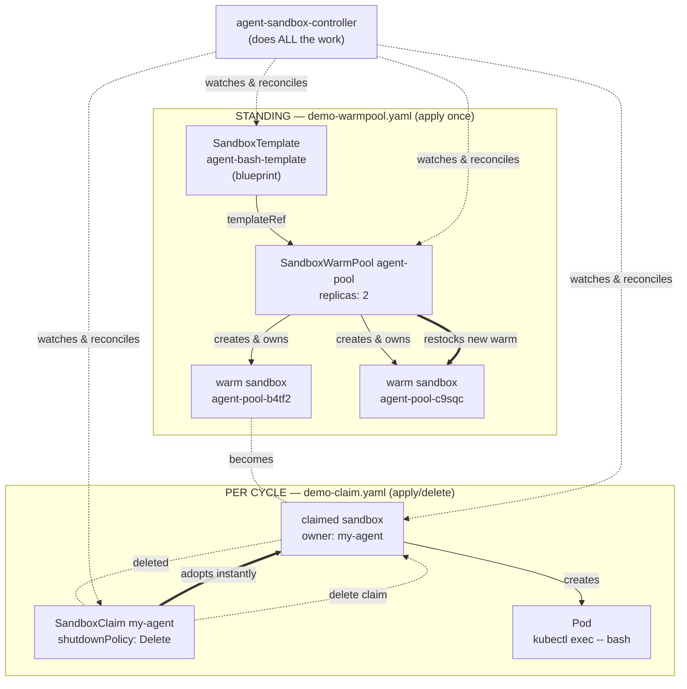

# Agent Sandbox — how it all fits together

Live walkthrough of our cluster (`kind-agent-sandbox`). Every name below is a
real object you can look at with k9s (`:sbt` `:swp` `:sbc` `:sbx`).

## The mental model (3 layers)

```
┌────────────────────────────────────────────────────────────────────────────┐
│ LAYER 1 — MACHINERY (installed once, lives forever)                          │
│   4 CRDs + agent-sandbox-controller.                                        │
│   The controller is the ONLY thing that ever creates/deletes anything.      │
│   You never touch Pods or PVCs directly — you just declare intent in YAML.  │
├────────────────────────────────────────────────────────────────────────────┤
│ LAYER 2 — THE FACTORY (standing, applied once: demo-warmpool.yaml)          │
│   SandboxTemplate = the blueprint (what a sandbox looks like)               │
│   SandboxWarmPool = the inventory manager (always keep 2 warm on the shelf) │
├────────────────────────────────────────────────────────────────────────────┤
│ LAYER 3 — THE WORK UNIT (ephemeral, every cycle: demo-claim.yaml)           │
│   SandboxClaim → adopts one warm Sandbox → its Pod is where you work.       │
│   Delete the claim → sandbox+pod destroyed → factory restocks itself.      │
└────────────────────────────────────────────────────────────────────────────┘
```

## Big picture diagram

```
                 ╔═══════════════════════════════════════════════════════╗
                 ║   agent-sandbox-controller  (the only worker)         ║
                 ║   namespace: agent-sandbox-system                    ║
                 ║   watches all 4 CRDs → creates/deletes/adopts stuff   ║
                 ╚═══════════════════╦═════════════════════════════════╝
                                     ▲  reconciles everything, forever
                                     │
  YOU ── apply demo-warmpool.yaml (ONCE)
    │
    ├─►  SandboxTemplate "agent-bash-template"      ← the BLUEPRINT
    │      image: debian:12-slim, runs `sleep infinity`, has bash
    │                     ▲
    │                     │  spec.sandboxTemplateRef
    │                     │
    └─►  SandboxWarmPool "agent-pool" (replicas: 2) ← the FACTORY
           │
           │ creates & owns            ┌────────────────────────────────┐
           ├──► agent-pool-b4tf2 ─────►│ Pod  Running, idle   (WARM #1) │
           └──► agent-pool-c9sqc ─────►│ Pod  Running, idle   (WARM #2) │
                                        └────────────────────────────────┘
```

## The claim cycle (your repeat loop)

```
  YOU ── apply demo-claim.yaml (EVERY CYCLE)
    │
    └─►  SandboxClaim "my-agent"    (lifecycle.shutdownPolicy: Delete)
           │
           │  "give me a warm one"  →  INSTANT adoption, no cold start
           │                            (it was already Running seconds ago)
           ▼
        Sandbox "agent-pool-wklxl"          k9s: OWNER column = my-agent
           │  owned by SandboxClaim/my-agent
           │  claim status.sandbox.name = agent-pool-wklxl
           ▼
         Pod ──►   kubectl exec -it agent-pool-wklxl -- bash
                   ^^^^^^^^^^^^^^^^^ your work happens in here ^^^^^^^^^

  YOU ── kubectl delete -f demo-claim.yaml
    │
    └─►  sandbox + pod destroyed instantly (shutdownPolicy: Delete)
         factory restocks: builds a NEW warm standby → back to 2 on the shelf
    │
    └────────────── repeat from "apply demo-claim.yaml" ──────────────┘
```

## Who creates what

| Object                 | Who creates it          | Owned by (k9s OWNER col / shift-j) | Lifetime            |
|------------------------|-------------------------|-------------------------------------|---------------------|
| CRDs + controller      | release YAML (once)     | —                                   | life of cluster      |
| SandboxTemplate        | you, once               | you                                | standing             |
| SandboxWarmPool        | you, once               | you                                | standing             |
| warm Sandboxes (2)     | **controller**          | SandboxWarmPool "agent-pool"       | standing, auto-refill|
| claimed Sandbox         | **controller** (adopted)| SandboxClaim "my-agent"             | until claim deleted  |
| Pod                    | **controller**          | its Sandbox                        | same as its sandbox  |
| PVC (if template has one)| **controller**        | its Sandbox                        | same as its sandbox  |

## Files → objects

| File                             | Creates                          | Applied   |
|----------------------------------|---------------------------------------------|
| `sandbox-with-extensions.yaml` (upstream release, v1.0.11) | 4 CRDs + controller | once, forever |
| `demo-warmpool.yaml`             | SandboxTemplate + SandboxWarmPool| once      |
| `demo-claim.yaml`                | SandboxClaim                     | per cycle |

## Same thing, mermaid version



## How to read it in k9s

| k9s view | What it answers |
|----------|-----------------|
| `:sbt`   | what blueprint exists |
| `:swp`   | factory health: `READY/DESIRED` (want 2/2) |
| `:sbc`   | which claim holds which sandbox (`SANDBOX` column) |
| `:sbx`   | every sandbox + who owns it (`OWNER` column: `my-agent` = claimed, `agent-pool` = warm) |
| `:po`    | the actual running containers |

Everything follows Kubernetes' declarative model: you never say "create a pod
for me" — you say "this is the state I want" (template/pool/claim YAML), and the
controller continuously makes reality match it.
