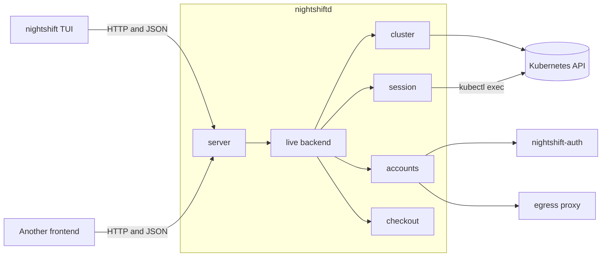
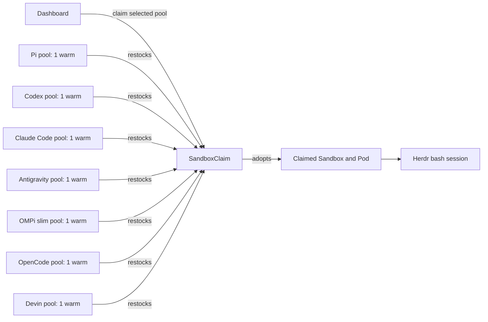
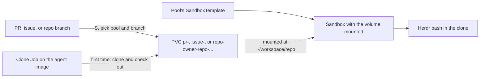
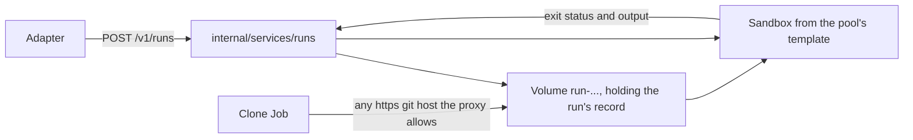

# Nightshift architecture

Nightshift combines a Kubernetes sandbox fleet with a terminal dashboard and
GitHub views. The automated ticket-to-merge workflow is still on the roadmap.
Nightshift runs in the `nightshift` namespace of any Kubernetes cluster, on
`kind-agent-sandbox` by default.

## Two programs

Nightshift is **nightshift-services** and any number of frontends, with one
contract between them. The services own everything that touches Kubernetes.
A frontend, such as the terminal UI, draws screens and turns keys into API
calls; it holds no kubeconfig and runs no `kubectl`. `docs/api.md` has the
contract's rules, and `api/openapi.yaml` is the contract itself.



```text
api/            the contract: openapi.yaml, v1 (types), client (Go SDK)
cmd/nightshiftd the services as a daemon
cmd/nightshift  the terminal UI: a client, it runs nothing else
cmd/nightshift-auth  the login service: signs accounts in, renews, publishes
internal/services/{cluster,session,accounts,checkout,runs,server,live,daemon,egress,auth}
internal/tui/{app,dashboard,accountsview,repoview,dialog,fleet}
```

Everything runs in the cluster, each part in its own pod: the services
(`nightshiftd`), the egress proxy, the login service (`nightshift-auth`),
and the sandboxes. The laptop runs only the terminal. `nightshiftd` acts through a service account with `NIGHTSHIFT_CONTEXT=-` and reach
nightshift-auth and the egress proxy by their Service addresses. In the cluster,
many people on many machines use one address and nobody needs a kubeconfig. The
manifests assume no provider, the setup script builds and loads an image on kind
and pulls one anywhere else, and the services' permissions are pinned by
`TestTheServicesHaveLeastPrivilege`. One server serves one cluster; a frontend
can talk to several servers. Run one replica per cluster: what a server keeps in
memory, the progress of running checkouts and its connections into sandboxes, is
rebuilt from the cluster after a restart.

Two things keep the halves apart. The terminal UI imports only `api/v1` and
`api/client`, which `internal/architecture_test.go` enforces in both directions,
and the HTTP layer imports nothing of the cluster, so the contract is the only
thing they share.

## Sandbox fleet

The agent-sandbox controller reconciles four resource types: a
`SandboxTemplate` defines each pod, a `SandboxWarmPool` keeps standbys ready,
a `SandboxClaim` requests a workspace from one pool, and a `Sandbox` owns the
resulting pod. Nightshift does not create or delete pods directly; for pull
request volumes it creates a Sandbox and a clone Job, whose controllers make
the pods.



`k8s/warmpool.yaml` defines seven templates and pools, each with one standby.
`k8s/warmpool.sh` writes it, one pair per directory under
`images/agent/agents`, so a new agent needs no hand-written YAML:

| Agent | Pool | Template | Image |
| --- | --- | --- | --- |
| Pi | `pi-pool` | `pi-template` | `ghcr.io/tmih06/nightshift-pi:latest` |
| Codex | `codex-pool` | `codex-template` | `ghcr.io/tmih06/nightshift-codex:latest` |
| Claude Code | `claude-code-pool` | `claude-code-template` | `ghcr.io/tmih06/nightshift-claude-code:latest` |
| Antigravity | `agy-pool` | `agy-template` | `ghcr.io/tmih06/nightshift-agy:latest` |
| OMPi slim | `ompig-slim-pool` | `ompig-slim-template` | `ghcr.io/tmih06/nightshift-ompig-slim:latest` |
| OpenCode | `opencode-pool` | `opencode-template` | `ghcr.io/tmih06/nightshift-opencode:latest` |
| Devin | `devin-pool` | `devin-template` | `ghcr.io/tmih06/nightshift-devin:latest` |

Every pod requests 100m CPU and is
limited to 1000m CPU and 2Gi memory; OpenCode requests 512Mi memory and the
others request 128Mi. Images use `Always` with mutable
`latest` tags; existing pods do not update just because a tag changes. See
`images/agent/README.md` for image publishing, registry access, reproducibility,
and the limits of this budget.

## Claim cycle

Select a warm sandbox in the dashboard and press `c` to claim its pool. When
no warm sandbox is selected, `c` defaults to Pi. Alternatively, `sbx` defaults
to Pi and accepts `POOL=codex-pool`, `POOL=claude-code-pool`, `POOL=agy-pool`,
`POOL=ompig-slim-pool`, `POOL=opencode-pool`, or `POOL=devin-pool`; `k8s/claim.yaml` is a Pi
example. A claim adopts any available sandbox in the chosen pool, not
necessarily the exact selected pod.
The controller replenishes that pool. Deleting a claim destroys its sandbox
and pod because its shutdown policy is `Delete`.

An agy sandbox is ready to run when it boots: `agy-template`'s start command
marks first-run setup done, trusts home and each folder in the workspace (agy
matches exact paths), and sets agy to proceed without asking. The sandbox and
the egress proxy are what contain it. A repository cloned later by hand still
gets agy's one trust question.

A Devin sandbox boots the same way: `devin-template` writes Devin's config with
approvals off and self-updates off, since the image pins the version that was
built and checked. Its login comes with the others from nightshift-auth and
holds only `nightshift:secret:DEVIN_ACCESS_TOKEN`; nobody signs in inside a
sandbox, and Devin's login hosts are closed to it. Devin speaks
Connect RPC to `server.codeium.com` and sends its key in the `Authorization`
header and inside each protobuf request, so its proxy rule sets
`proto_bodies`: the proxy swaps placeholders inside protobuf string fields,
re-encoding the lengths around them, and cleans protobuf replies the same way,
answering every email address in them with `nightshift@proxy.local`
(`proto_email`).

### One agent, three places

An agent is one entry in `internal/services/agent` (how its pools are named,
its models, and its unattended task command) and one directory under
`images/agent/agents` (how its image installs it and finds its latest
release). `k8s/warmpool.sh` makes its template and pool from that directory,
and both image workflows list their matrix from it.
`TestEveryAgentHasAnImageAndAPool` and `TestWarmPoolIsWhatTheAgentsRender`
fail until the three agree.

## Pull request, issue, and repository volumes

`S` on a pull request, issue, or repository/branch in the GitHub tab gives it a
volume that outlives any sandbox. gh-dash or the Repo view sends the target to
the root model, which asks for a pool (and a branch name for an issue or
repository), offering only the pools the cluster keeps warm (an agent with no
signed-in account has its pool at zero, and its sandbox could not reach its
provider), forks a right-side model submenu for that pool's harness, and
hands the checkout—along with the chosen harness and model—to the sandbox tab.



A claim cannot do this. A warm pod is already running, and a pod's volumes
are fixed at creation. A claim's `volumeClaimTemplates` force a cold start,
and the controller makes those PVCs owned by the sandbox, so they would be
deleted with it. Nightshift therefore creates and owns the PersistentVolumeClaim
itself, labelled `nightshift.dev/volume`. A Job on the pool's image clones
into the volume's `repo` directory as the sandbox's user. The volume's root
belongs to root, where git refuses to work for that user. The volume is then
annotated as cloned and the Job is deleted. Nightshift then creates a `Sandbox` directly from
the pool's template, with that directory mounted as a subPath. The warm pool
does not count it, as it carries no pool label.

The clone script turns git's carriage-return progress into lines,
unbuffered, so the dashboard can follow it from the Job's log while the clone
runs. The whole checkout runs as one background step that reports each
stage to the sandbox tab.

Destroying that sandbox asks whether the volume goes too. Keeping it deletes
the Sandbox and its pod only. Volumes are named `pr-<owner>-<repo>-<n>`,
`issue-<owner>-<repo>-<n>`, or `repo-<owner>-<repo>-<branch>` (truncated and
hashed when longer than 63 characters). Picking the same pull request, issue,
or repository branch again mounts the kept volume without cloning (switching to
the requested branch for an issue or repository), or returns to the sandbox
already on it.
Dropping it also deletes the PersistentVolumeClaim, which Kubernetes removes
once the pod is gone. A clone that did not finish is redone from
scratch. The cluster's `standard` class is local-path, so a volume lives on
one node's disk and pins its sandboxes to that node.

Inside a claimed pod, Herdr keeps bash alive independently of the dashboard's
connection. The services read and interact with it through `kubectl exec`, and
frontends through the terminal endpoints of the API; see
`docs/session-manager.md`. Pod deletion or restart ends the session and
its ephemeral workspace. Credentials must be supplied at runtime, or isolated
outside the sandbox via Nightshift's optional lightweight Go egress proxy
(`cmd/egress-proxy`, `k8s/egress.yaml`, `k8s/egress-setup.sh`): a single
pod in `nightshift-egress` holds real API/GitHub credentials, enforces
default-deny host/method/path allowlists and SSRF-safe dialing, swaps opaque
`nightshift:secret:*` env placeholders on matched hosts only, and scrubs
reflected secrets from responses while `NetworkPolicy` blocks direct internet
and DNS from checkout sandboxes.

Interactive OAuth logins also fit the proxy model, because an OAuth access
token is just a bearer string. Claude Code, Codex, Antigravity (`agy`), and
Devin are signed in once, and every sandbox then boots logged in, yet no real
credential ever exists inside a sandbox. Each sandbox login holds a
placeholder (`nightshift:secret:CLAUDE_ACCESS_TOKEN`, `CODEX_ACCESS_TOKEN`,
`AGY_ACCESS_TOKEN`, or `DEVIN_ACCESS_TOKEN`) instead of the token, an expiry
far in the future so the agent never tries to refresh, and no usable refresh
token (Codex insists on one, so it gets an inert string). Each is built from a
named list of fields, and none of them names an account: no real email,
account or organization UUID, or real `id_token`. Where an agent expects an
email it gets the fixed `nightshift@proxy.local` (Codex needs an `id_token` to
start, so it gets an unsigned one naming that and a plan). Which account
carries a request is the proxy's per-attempt decision, so the sandbox is told
none. The TUI shows it instead, from the proxy's live pool state. The proxy
swaps each placeholder for the real token on that agent's hosts:
`api.anthropic.com`, `chatgpt.com`, `cloudcode-pa.googleapis.com`, and
`server.codeium.com`. A login file with no identity is not enough on its own:
agy asks Google who its token belongs to, and would be told the real account.
The proxy answers that itself with `nightshift@proxy.local` (a rule's
`answers`; with a blank email agy's `/usage` loads forever), forwards nothing
under `www.googleapis.com`, and injects no login there. Codex looks its
`account_id` up in `chatgpt.com`'s `/backend-api/wham/accounts/check` and
refuses to run when it is missing, so the proxy answers that path with the
placeholder id. The proxy carries no WebSockets: it answers an upgrade with
`426 Upgrade Required`, on which Codex switches to HTTP without retrying. The
`sandbox-egress-env` ConfigMap sets `CLAUDE_CODE_OAUTH_TOKEN` and never
`ANTHROPIC_API_KEY`, which Claude Code gives precedence over every OAuth path.

### nightshift-auth

Signing in needs a person with a browser, and the tokens then expire and
rotate, so exactly one process holds the refresh tokens: `nightshift-auth`
(`cmd/nightshift-auth`, `internal/services/auth`, `k8s/auth.yaml`, installed
by `k8s/auth-setup.sh`). It is a small static program of its own, one replica
on a private volume, and it never serves model traffic.

- **Sign-in.** Each agent lists its ways in, and the Accounts tab offers them
  all. A browser sign-in gives a link; the person approves and pastes back
  what the browser ends on: the code Anthropic's page shows, or the
  localhost address that will not load in a cluster. A device sign-in
  (Codex) shows a code to enter on the provider's page, and the tab asks
  after it until it is approved. A paste takes something made elsewhere:
  a CLI's login file (Codex's `auth.json`, Claude Code's
  `.credentials.json`, agy's token file), a `claude setup-token` token, or
  a Devin key. It exchanges codes with PKCE, renews a pasted login that is
  about to lapse, and keeps the tokens in its vault (`/data/accounts.json`,
  mode 0600, replaced atomically). A failed answer leaves the sign-in open
  to try again. Claude and Codex API keys are refused: they are billed per
  use and travel in other headers than the subscription tokens they would
  share a chain with.
- **Renewal.** Every minute it renews tokens within ten minutes of lapsing,
  saving the new refresh token before using it. A failed renewal waits five
  minutes; a login that can no longer be renewed (Devin's session tokens have
  no refresh grant) is taken out of its chain and asks to be signed in again.
- **Publishing.** After every change, and every five minutes, it writes the
  placeholder logins into `agent-creds` (the tar templates untar into `$HOME`
  at boot), each agent's ordered chain and primary token into `egress-secrets`
  (`POOL_`, `REAL_`, `LABEL_<secret>`, with companions such as Codex's
  `account_id`), and scales each agent's warm pool to one while it has an
  enabled account and every other pool to zero. It talks to the API server as
  its service account and needs no kubectl.

Each agent is one file in `internal/services/auth/providers` implementing
`Provider`: start a sign-in, finish it from the paste, renew, build the
sandbox login, and name the account-bound companions. The flows are ported from
ompig-slim's PiG (see that directory's README); adding an agent is a file and a
line in `All`, plus its proxy rule. `TestEveryAgentIsSwappedByTheProxy` fails
when an agent's secret is not bound and swapped on its hosts, and
`TestSandboxLoginsNameNoAccount` when a sandbox login carries the account.

The proxy binds those secrets to files on a mounted volume and re-reads them
every 15 seconds (`internal/services/egress/reload.go`), so a refreshed token
needs no restart; the kubelet takes up to about two minutes to update the
volume. nightshift-auth's service account may only write the two credential
secrets and the warm pool sizes (`TestTheLoginServiceHasLeastPrivilege`), and
its network policy admits only nightshiftd.

The **Accounts tab** (`internal/tui/accountsview`, over `internal/services/accounts`
and the `/v1/accounts` endpoints) is how people drive all of this from the TUI.
The services reach nightshift-auth's API through a `kubectl port-forward`
that they own and restart, and the egress proxy's admin port through another;
in the cluster they use the Services' addresses instead, so on a laptop nothing
is needed but the kubeconfig Nightshift already uses. It lists every signed-in account per agent, runs the
sign-in (the agent, then the way in, then the link, code, or paste), disables, removes, and
renews accounts, and publishes after each change. A change that would move an
agent's traffic to another account asks first, because prompt caches belong to
one account. The account marked active is the one the proxy's `/pools` reports,
not the first in the order. Only the Accounts tab says which account that is:
neither a sandbox nor its row in the Pods tab names one. Several accounts per
agent form an ordered fallback chain: the order picked
with `u` or `K`/`J` is kept by nightshift-auth, which publishes the whole
enabled chain as `POOL_<secret>` in `egress-secrets` (alongside companion placeholders
such as Codex's `account_id`). The egress proxy tries the first non-cooled-down
account (preserving prompt caches and starting rolling reset windows early) and
fails over down the chain on `429`, `401`, `403`, or `529`, honoring
`Retry-After` / rate-limit reset headers and clearing `401` cooldowns when a
refreshed token reloads. Usage and quota analytics come from the proxy: it tags every attempted request
with the account label that carried it, parses JSON and SSE responses for
model, input, output, cache read/write, and reasoning tokens plus latency and
rate-limit headers, counts them in ten-minute request and token windows at
`/usage` and `/analytics`, exposes live chain and cooldown state at `/pools`,
and actively fetches provider quota windows and next reset times from Claude,
Codex, and Antigravity at `/quota` and `POST /quota/refresh` (triggered with
`r` in the Accounts tab or periodically in the background). Antigravity's
reading is the grouped weekly and five-hour pool summary its own `/usage`
shows, not the per-model availability catalog. The same refresh lists each
account's models (`internal/services/egress/models.go`) as its CLI offers them:
agy's picker (`agentModelSorts` without the disabled), Codex's models marked
`list`, and Anthropic's `/v1/models`. Cooldowns and the quota cache
live in the proxy's memory and start over when it restarts.

Usage is durable. Every allowed upstream attempt is committed to a SQLite
database in one transaction with its account, status, latency, model, and token
metrics. Raw events stay in `usage_events` only for the rolling 24-hour
recent window, while all-time account, model, and daily aggregate tables keep
`/usage` fast and bounded. `/usage` therefore reports all recorded usage, and
`/history` serves up to 53 weeks of daily requests and tokens from a daily
aggregate table updated in the same transaction for the tab's calendar.
`EGRESS_USAGE_DB` names the database, which `egress.yaml` puts at
`/var/lib/egress/usage.db` on the `egress-usage` volume
(64Mi from the default StorageClass). A legacy JSON file named by
`EGRESS_USAGE_HISTORY` is imported once so existing calendars are not lost;
new writes go only to SQLite. That volume has one writer, so the deployment
replaces the pod (`Recreate`) instead of rolling it. When the database cannot
be opened or migrated, the proxy refuses to start rather than running without
usage persistence.

The tab draws each account's quota as meters grouped by model family (the
account's own windows first), with a tick for how much of the window has
passed, then the calendar (`v` switches between this account and all of them)
and the usage counts. The details scroll with `ctrl+u`/`ctrl+d` or the
wheel.

Nothing here is specific to kind. `NIGHTSHIFT_CONTEXT` selects the kubeconfig
context for the scripts and the TUI, the manifests pin no service address, and
`egress-setup.sh` pulls the published proxy image on any cluster that is not
kind (`EGRESS_IMAGE` points it at your own registry, `EGRESS_BUILD=1` builds
and pushes one). The cluster needs a default StorageClass for nightshift-auth's
volume and a network plugin that enforces `NetworkPolicy`. Secrets live in
ordinary Kubernetes Secrets, so an external secret manager that syncs into
them (External Secrets, a CSI driver) slots in without changing the proxy.

Two cluster facts shape the wiring. Sandbox pods use external DNS resolvers
(`8.8.8.8`, `1.1.1.1`, set by the agent-sandbox controller), so cluster
service names never resolve for them: `egress-setup.sh` reads the proxy
Service's assigned `clusterIP` and patches it into `sandbox-egress-env`, which
the manifest therefore leaves unset (a plain `kubectl apply` must not reset it).
And the agent-sandbox controller generates a NetworkPolicy per template allowing
egress to the public internet but denying all private ranges, which includes
the proxy's ClusterIP; `sandbox-egress-proxy-access` additively re-opens the
proxy path for sandbox pods only (network policies are union-permissive, so no
rule of the controller's needs changing). It must not select every pod: an
empty selector would isolate nightshift-auth too. Note the corollary: warm pool
pods retain direct internet access — credential safety rests on placeholders
being worthless off the proxy path, not on network restriction. Tightening
templates to proxy-only egress is possible through the template
`networkPolicy` field but will break any tool the proxy rules do not cover.

## Runs

A run is a task given to a coding agent through `/v1/runs`. It is how work from
outside, such as an issue tracker's tickets, reaches the fleet: an adapter per
tracker calls the API, and the services never learn which tracker it is.



It reuses the checkout's clone Job and volume sandbox. The agent runs in its
non-interactive mode from a script that `hc run` starts in a new terminal, so it
shows in the Pods tab like any other, and the services keep no connection to the
sandbox open. The script leaves the exit status in a file,
which the services poll with `kubectl exec`. The run's record is an annotation
on its volume, so a restarted server finds it again and needs no new
permission. See `docs/api.md` for the contract and its limits.

## Operating the cluster

Apply `k8s/warmpool.yaml` after installing the agent-sandbox controller and
ensuring the GHCR images are accessible. This creates `pi-pool` but does not
remove the old `agent-pool` or the `agent-bash-template` template. Existing
claims may still reference the old resources; do not delete them as part of
migration. Review and remove old resources separately after obtaining permission. Applying the
manifest does not remove unrelated resources or stale pools.

Use k9s or kubectl to inspect `SandboxTemplate` (`sbt`), `SandboxWarmPool`
(`swp`), `SandboxClaim` (`sbc`), `Sandbox` (`sbx`), and pod resources in
`nightshift`. Pull request volumes stay until removed by hand:
`kubectl delete pvc -l nightshift.dev/volume` removes all of them, once no
sandbox mounts them. The default claim loop is `SBX_NO_EXEC=1 sbx`, which removes
only the claim it creates. See `CONTEXT.md` for dashboard and verify commands.

For multi-node clusters, image access and scheduling apply to every node. The
template's PodSpec can use affinity, topology spread, or runtime classes;
network storage is needed if state must outlive a pod. Warm-pool refill and
controller concurrency may need tuning at larger scale.
