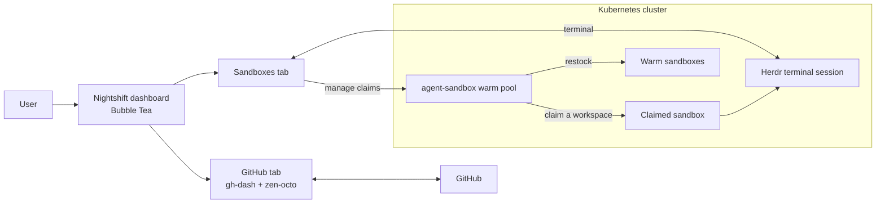

# Nightshift

Nightshift is a software factory. You hand it a ticket, and it carries the
work all the way to a merged pull request while you get on with something
else.

## How it works

1. **Pick up a ticket.** Nightshift takes the next task from your backlog.
2. **Give it a workspace.** Each task gets its own private, disposable
   workspace, ready in seconds, so jobs never step on each other.
3. **Let an agent do the work.** A coding agent works inside that workspace
   until the task is done.
4. **Open a pull request.** The finished work is proposed for review like any
   other change.
5. **Babysit the pull request.** Nightshift keeps watching. It resolves merge
   conflicts, fixes failing checks, and answers review feedback until the
   change is ready to merge.
6. **Clean up.** When the job is over, the workspace is thrown away and a
   fresh one takes its place.

You can watch every workspace from one dashboard, see how hard each one is
working, and step into any of them to look over the agent's shoulder. A
second tab in the same dashboard follows your GitHub work: the pull requests
themselves, from the first comment to the merge, along with issues and
notifications.

## Architecture

Today, Nightshift brings the sandbox fleet and GitHub work together in one
terminal dashboard. The automated ticket-to-merge workflow is still on the
roadmap below.

See [ARCHITECTURE.md](ARCHITECTURE.md) for the sandbox lifecycle in more detail.

## Built with

Nightshift builds on these projects:

- [agent-sandbox](https://github.com/kubernetes-sigs/agent-sandbox) manages
  the sandbox pool and claims.
- [Kubernetes](https://kubernetes.io/) runs the sandboxes.
- [Bubble Tea](https://github.com/charmbracelet/bubbletea) powers the terminal
  dashboard.
- [gh-dash](https://github.com/dlvhdr/gh-dash) provides the GitHub dashboard.
- [zen-octo](https://github.com/praxis-labs-io/zen-octo) provides the pull
  request view.
- [herdr-core](https://github.com/herdrdev/herdr-core) keeps sandbox terminal
  sessions alive.

## Roadmap

### Workspaces

- [x] Keep a few workspaces warm so a new job starts instantly
- [x] Claim a workspace for a job and throw it away when the job is done
- [x] Restock the warm workspaces automatically
- [x] Cap how much each workspace can use
- [x] Ship each workspace with a coding agent and everyday developer tools
- [x] Offer workspaces with a choice of coding agent, kept up to date

### Dashboard

- [x] See every workspace at a glance, grouped by kind and machine
- [x] Watch each workspace's activity over time
- [x] Step into a workspace's terminal without leaving the dashboard
- [x] Keep a workspace's terminal alive after you look away or close the
      dashboard
- [x] Claim and destroy workspaces from the dashboard
- [x] Read, discuss, review, and merge pull requests from the dashboard
- [x] Switch between workspaces and pull requests with tabs

### The factory

- [ ] Pick up tickets from an issue tracker
- [ ] Start a workspace and an agent for each ticket on its own
- [ ] Have the agent open a pull request when the task is done
- [ ] Resolve merge conflicts on open pull requests
- [ ] Fix failing checks on open pull requests
- [ ] Respond to review comments
- [ ] Report progress back on the ticket
- [ ] Clean up when the pull request merges or closes
- [ ] Run many tickets side by side

## License

Nightshift is licensed under the [Apache License 2.0](LICENSE). See
[NOTICE](NOTICE) for attribution notices.
