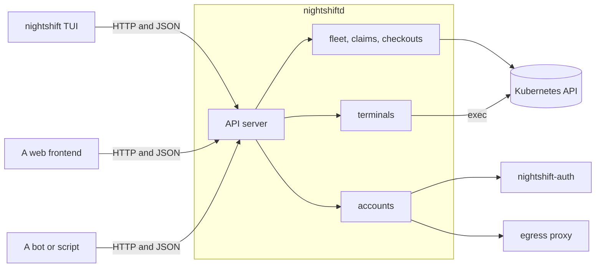
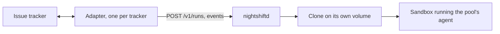

# The Nightshift services API

Nightshift is two programs with one contract between them.

- **nightshift-services** (`cmd/nightshiftd`) is the core stack. It owns
  everything that touches Kubernetes: the sandbox fleet, claims, volumes and
  checkouts, runs, the terminals inside sandboxes, and the coding-agent
  accounts.
- **nightshift-tui** (`cmd/nightshift`) is one frontend. It draws screens and
  turns key presses into API calls. It runs no `kubectl`, reads no cluster
  state, and imports no service code.

Anyone can write another frontend: a web page, a chat bot, a script, an IDE
panel. The contract they build against is `api/openapi.yaml`, with the same
bodies as Go types in `api/v1`.



## Where the services run

The services act on one cluster, through whatever `kubectl` is allowed to do.
Nothing in them knows which Kubernetes provider that cluster is, so the same
build serves kind, GKE, EKS, AKS, k3s, or a bare-metal cluster. Two ways to run
them, with one API either way:

| Mode | Where | How it reaches the cluster |
| --- | --- | --- |
| Local | A laptop or a CI job, started by `nightshift` or by hand | The kubeconfig context in `NIGHTSHIFT_CONTEXT` (default `kind-agent-sandbox`) |
| In-cluster | A Deployment in the `nightshift` namespace | Its ServiceAccount, with the least privilege that covers the API |

In-cluster is what makes Nightshift distributed. The services live next to the
sandboxes, many people and many machines connect to one address, and nobody
needs a kubeconfig. Locally, the services reach nightshift-auth and the egress
proxy through port-forwards; in-cluster they use the Services' own addresses.
The choice is configuration, not code: `--auth-url` and `--proxy-url` replace
the port-forwards.

A frontend can talk to several servers, one per cluster. `GET /v1` says which
cluster a server acts on, so a frontend can label them. Nothing in the API
assumes there is only one.

State the services keep is small and rebuilt from the cluster: the fleet is
read from Kubernetes on every request, volumes and accounts live in the
cluster, and a checkout in progress is a Kubernetes volume and sandbox whether
or not any server remembers it. What a server holds in memory is only the
progress of running checkouts and its connections into sandboxes (a run's record
is kept on its volume). So run one
replica per cluster; a restart loses nothing but the progress display.

## Reaching the services

- **Address.** `NIGHTSHIFT_API` on the frontend, `--listen` on the server.
  Default `http://127.0.0.1:7777`.
- **Authentication.** Every endpoint but `/v1/healthz` needs
  `Authorization: Bearer <token>`, always, even on loopback. The API can open a
  shell in a sandbox, so it is never open. The server reads the token from
  `--token-file` (or `NIGHTSHIFT_TOKEN`), and compares in constant time.
- **Network.** The server refuses a non-loopback `--listen` unless it also has
  `--tls-cert` and `--tls-key`, or is told with `--plain-http` that something else
  protects the traffic: a ClusterIP Service reached through `kubectl
  port-forward`, or an ingress that terminates TLS. It checks the `Host` header
  against loopback and the names given with `--allow-host`, which defeats DNS
  rebinding from a web page; behind a gateway with names of its own,
  `--any-host` turns that check off and the token still guards everything. It
  sends no CORS headers; a browser frontend needs a server of its own, or a
  gateway that adds them.
- **In the cluster.** `k8s/nightshiftd.yaml` runs the services as a Deployment
  with a service account of the least privilege they need (pinned by
  `TestTheServicesHaveLeastPrivilege`), `NIGHTSHIFT_CONTEXT=-` so `kubectl` uses
  that account instead of a kubeconfig, and `--auth-url` and `--proxy-url` set to
  the Services' addresses. `k8s/nightshiftd-setup.sh` installs it on any
  provider: it builds and loads the image on kind and pulls it anywhere else
  (`NIGHTSHIFTD_IMAGE` and `NIGHTSHIFTD_BUILD=1` point it at your registry),
  makes the token, and binds log access only in namespaces the cluster has.
  The API Service is a ClusterIP. Reach it with `kubectl port-forward`, or put
  the ingress of your provider in front of it. Nightshift ships no
  provider-specific load balancer, on purpose.

## Rules of the contract

- The API is versioned in the path: `/v1`. Inside v1 a field is only ever
  added. Removing or renaming one, or changing what one means, is v2, which
  runs beside v1 for as long as v1 has a user.
- A client ignores fields it does not know. A server ignores request fields it
  does not know.
- Optional parts are announced in `GET /v1` as capabilities, so a frontend
  built for a larger server still works against a smaller one.
- Enumerations are lowercase strings. A client treats a value it does not know
  as "other".
- Times are RFC 3339 in UTC.
- Errors are `application/problem+json` with a stable `code`; a frontend
  branches on the code, never on the text.
- No response carries a credential. Accounts have no token fields, the
  management key never leaves the server, and `GET /v1/fleet` shows manifests
  but no Secret.
- Streams are server-sent events. They need nothing but HTTP, work through
  proxies, and every language reads them.
- Anything that takes longer than a request (a checkout clones a repository)
  runs in the server. The request returns a resource; its progress is a
  stream. A frontend that closes does not stop the work.

## What the API offers

| Area | Endpoints | Implemented by |
| --- | --- | --- |
| Meta | `GET /v1`, `/v1/healthz`, `/v1/openapi.yaml` | `internal/services/server` |
| Fleet | `GET /v1/fleet`, `/v1/fleet/watch`, `/v1/pods/{ns}/{name}/logs` | `internal/services/cluster`, through `live` |
| Claims | `POST /v1/claims`, `GET` and `DELETE /v1/claims/{name}` | `internal/services/cluster` |
| Checkouts | `POST /v1/checkouts`, `GET /v1/checkouts/{id}`, `/events`, `GET /v1/volumes`, `DELETE /v1/volumes/{name}`, `DELETE /v1/sandboxes/{name}` | `internal/services/checkout` |
| Runs | `POST` and `GET /v1/runs`, `GET` and `DELETE /v1/runs/{id}`, `/events` | `internal/services/runs` |
| Terminals | `/v1/sandboxes/{name}/terminals`, `.../{address}/screen`, `.../input` | `internal/services/session` |
| Accounts | `/v1/accounts` and its sub-resources | `internal/services/accounts` |

A fleet read takes `include`: `configs` for manifests, `live` for CPU and memory
read from each pod's cgroup, `versions` for each agent's version, and
`terminals` for each claimed sandbox's terminals, so a frontend gets what a
screen shows in one call. Each pool says which agent it runs and which models it
takes, and volume names (`api/v1/volumes.go`) are part of the contract, so a
frontend can show a volume before it exists and recognise it afterwards.

The GitHub side of the TUI, pull requests, issues, and notifications, is not
part of the services. It talks to GitHub with the person's own `gh` login, as
gh-dash does, and stays in the frontend. Runs are the first part of the ticket
to merge workflow. Reading tickets stays outside the services, in adapters.

## Runs

A run hands a task to a coding agent and reports how it ended. It is the gate
for an issue tracker, or anything else that has work to give: the services learn
no tracker's name and hold none of its credentials.



An adapter is an ordinary client of this API. It reads tickets, creates a run
for each, follows it, and writes the result back to its tracker:

```sh
curl -H "Authorization: Bearer $NIGHTSHIFT_TOKEN" "$NIGHTSHIFT_API/v1/runs" -d '{
  "source": {"cloneUrl": "https://github.com/owner/name.git"},
  "prompt": "Fix the crash described below. ...",
  "pool": "claude-code-pool",
  "externalRef": "linear:ENG-42",
  "idempotencyKey": "linear:ENG-42:1"
}'
curl -N -H "Authorization: Bearer $NIGHTSHIFT_TOKEN" "$NIGHTSHIFT_API/v1/runs/$ID/events"
```

Go adapters use `api/client`: `CreateRun`, `FollowRun`, `Runs`, `DeleteRun`.

- **States** are `queued`, `cloning`, `starting`, `working`, then `done` or
  `failed`. `done` means the agent exited with status zero. Nothing checks
  that it did the task, so an adapter that cares has to.
- **The result** is `exitCode` and `output`, the last 16 KiB the agent
  printed. The changes stay on the run's volume. The sandbox has no git
  credential helper, so Nightshift does not push them or open a pull request.
- **Cleaning up** is the caller's job. The sandbox keeps running, and the
  volume keeps its disk, until `DELETE /v1/runs/{id}`, which destroys both.
  The TUI's Pods tab shows a run's sandbox, and its shell shows the agent
  working.
- **Asking twice** is safe with an `idempotencyKey`: it names the run's volume,
  so the same key returns the same run until that run is deleted. Use a new key
  to try the same ticket again.
- **Approvals are off.** The agent runs with its skip-permissions flag, as
  nobody is there to answer, so the sandbox is what contains it. A prompt built
  from a ticket is untrusted text: an adapter decides whose tickets may start
  runs. The token is not scoped, and whoever holds it can use the whole API.
- **Other git hosts** are accepted by the contract, but sandboxes reach the
  network only through the egress proxy. A host other than GitHub needs a rule
  in `k8s/egress.yaml`, or the clone fails with a 403. Private repositories on
  such a host also need their credential handling added; only GitHub has it.
- **A restart** keeps every run, as its record is on its volume. A working
  agent is picked up again. A run cut off before its agent started is marked
  `failed`, because the prompt is not stored.
- **Limits.** Three runs are set up at a time and the rest wait as `queued`.
  Working runs are not capped; the cluster's capacity is the limit.

## Terminals

A terminal belongs to its sandbox. It keeps running when a frontend goes away,
and another frontend can pick it up. The API gives a frontend what it needs to
draw one without knowing how it is hosted:

- `GET .../screen?cols=&rows=&wait=&viewer=` returns the rendered screen, as lines
  with ANSI styling, waiting up to `wait` ms for a change. Each `viewer` id has its
  own view, so two frontends can watch one terminal, each at its own size,
  without taking each other's changes.
- `POST .../input?viewer=` presses keys, in order. A terminal takes the size of
  whoever typed last, so a frontend sends the `viewer` id it watches with.
  Without one, the terminal keeps the size it has.
- `POST .../terminals` and `DELETE` open and stop terminals.

A frontend with a real terminal widget gets raw bytes by decoding the ANSI;
one without draws the lines. A raw byte stream (a WebSocket) is not in v1; when
it is added it arrives as a capability, `terminal.raw`.

## Changing the contract

1. Edit `api/openapi.yaml` and `api/v1` together.
2. `api/contract_test.go` fails until they agree: every schema property is a Go
   field and the other way round, `required` matches `omitempty`, and no field
   can carry a credential.
3. `internal/services/server`'s route test fails until the server implements
   exactly the paths and methods the document lists.
4. A change that is not an addition is a new version, not an edit.

## Using it

```sh
# The services run in the cluster, as the nightshiftd pod. Deploy them once.
k8s/nightshiftd-setup.sh

# Reach it from your machine: a port-forward, or an ingress with TLS
# (NIGHTSHIFTD_HOST=nightshift.example.com k8s/nightshiftd-setup.sh).
kubectl -n nightshift port-forward svc/nightshiftd 7777:7777 &
export NIGHTSHIFT_API=http://127.0.0.1:7777
export NIGHTSHIFT_TOKEN=$(kubectl -n nightshift get secret nightshiftd-token \
  -o jsonpath='{.data.token}' | base64 -d)

# Any client: list the fleet.
curl -H "Authorization: Bearer $NIGHTSHIFT_TOKEN" "$NIGHTSHIFT_API/v1/fleet"

# The terminal UI, a client of the same server.
nightshift
```
