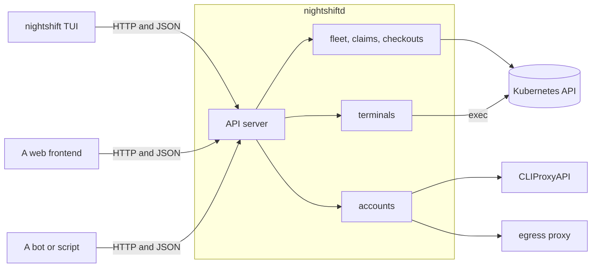

# The Nightshift services API

Nightshift is two programs with one contract between them.

- **nightshift-services** (`cmd/nightshiftd`) is the core stack. It owns
  everything that touches Kubernetes: the sandbox fleet, claims, volumes and
  checkouts, the terminals inside sandboxes, and the coding-agent accounts.
- **nightshift-tui** (`cmd/nightshift`) is one frontend. It draws screens and
  turns key presses into API calls. It runs no `kubectl`, reads no cluster
  state, and imports no service code.

Anyone can write another frontend: a web page, a chat bot, a script, an IDE
panel. The contract they build against is `api/openapi.yaml`, with the same
bodies as Go types in `api/v1`.



## Where the services run

The services act on one cluster, through whatever `kubectl` is allowed to do.
Nothing in them knows which Kubernetes provider that cluster is, so the same
build serves kind, GKE, EKS, AKS, k3s, or a bare-metal cluster. Two ways to run
them, with one API either way:

| Mode | Where | How it reaches the cluster |
| --- | --- | --- |
| Local | A laptop or a CI job, started by `nightshift` or by hand | The kubeconfig context in `NIGHTSHIFT_CONTEXT` (default `kind-agent-sandbox`) |
| In-cluster | A Deployment in the `nightshift` namespace | Its ServiceAccount, with the least privilege that covers the API |

In-cluster is what makes Nightshift distributed. The services live next to the
sandboxes, many people and many machines connect to one address, and nobody
needs a kubeconfig. Locally, the services reach CLIProxyAPI and the egress
proxy through port-forwards; in-cluster they use the Services' own addresses.
The choice is configuration, not code: `--cpa-url` and `--proxy-url` replace
the port-forwards.

A frontend can talk to several servers, one per cluster. `GET /v1` says which
cluster a server acts on, so a frontend can label them. Nothing in the API
assumes there is only one.

State the services keep is small and rebuilt from the cluster: the fleet is
read from Kubernetes on every request, volumes and accounts live in the
cluster, and a checkout in progress is a Kubernetes volume and sandbox whether
or not any server remembers it. What a server holds in memory is only the
progress of running checkouts and its connections into sandboxes. So run one
replica per cluster; a restart loses nothing but the progress display.

## Reaching the services

- **Address.** `NIGHTSHIFT_API` on the frontend, `--listen` on the server.
  Default `http://127.0.0.1:7777`.
- **Authentication.** Every endpoint but `/v1/healthz` needs
  `Authorization: Bearer <token>`, always, even on loopback. The API can open a
  shell in a sandbox, so it is never open. The server reads the token from
  `--token-file` (or `NIGHTSHIFT_TOKEN`), and compares in constant time.
- **Network.** The server refuses a non-loopback `--listen` unless it also has
  `--tls-cert` and `--tls-key`, or is told it sits behind a TLS terminator
  (`--behind-tls-proxy`). It checks the `Host` header against the addresses it
  was given, which defeats DNS rebinding from a web page. It sends no CORS
  headers; a browser frontend needs a server of its own, or a gateway that adds
  them.
- **Exposure in-cluster.** The Service is ClusterIP. Reach it with
  `kubectl port-forward`, or put the ingress of your provider in front of it.
  Nightshift ships no provider-specific load balancer, on purpose.

## Rules of the contract

- The API is versioned in the path: `/v1`. Inside v1 a field is only ever
  added. Removing or renaming one, or changing what one means, is v2, which
  runs beside v1 for as long as v1 has a user.
- A client ignores fields it does not know. A server ignores request fields it
  does not know.
- Optional parts are announced in `GET /v1` as capabilities, so a frontend
  built for a larger server still works against a smaller one.
- Enumerations are lowercase strings. A client treats a value it does not know
  as "other".
- Times are RFC 3339 in UTC.
- Errors are `application/problem+json` with a stable `code`; a frontend
  branches on the code, never on the text.
- No response carries a credential. Accounts have no token fields, the
  management key never leaves the server, and `GET /v1/fleet` shows manifests
  but no Secret.
- Streams are server-sent events. They need nothing but HTTP, work through
  proxies, and every language reads them.
- Anything that takes longer than a request (a checkout clones a repository)
  runs in the server. The request returns a resource; its progress is a
  stream. A frontend that closes does not stop the work.

## What the API offers

| Area | Endpoints | Replaces, in the old TUI |
| --- | --- | --- |
| Meta | `GET /v1`, `/v1/healthz`, `/v1/openapi.yaml` | Nothing: new |
| Fleet | `GET /v1/fleet`, `/v1/fleet/watch`, `/v1/pods/{ns}/{name}/logs` | `cluster.Fetch`, cgroup sampling, agent versions, `PodLogs` |
| Claims | `POST /v1/claims`, `GET` and `DELETE /v1/claims/{name}` | `cluster.Claim`, `WaitForClaim`, `DeleteClaim` |
| Checkouts | `POST /v1/checkouts`, `GET /v1/checkouts/{id}`, `/events`, `GET /v1/volumes`, `DELETE /v1/volumes/{name}`, `DELETE /v1/sandboxes/{name}` | The pipeline in `internal/dashboard/checkout.go` |
| Terminals | `/v1/sandboxes/{name}/terminals`, `.../{address}/screen`, `.../input` | `internal/session` |
| Accounts | `/v1/accounts` and its sub-resources | `internal/accounts` |

The GitHub side of the TUI, pull requests, issues, and notifications, is not
part of the services. It talks to GitHub with the person's own `gh` login, as
gh-dash does, and stays in the frontend. When Nightshift grows its ticket to
merge workflow, that workflow is a service, and it gets endpoints here.

## Terminals

A terminal belongs to its sandbox. It keeps running when a frontend goes away,
and another frontend can pick it up. The API gives a frontend what it needs to
draw one without knowing how it is hosted:

- `GET .../screen?cols=&rows=&wait=` returns the rendered screen, as lines with
  ANSI styling, waiting up to `wait` ms for a change.
- `POST .../input` presses keys, in order.
- `POST .../terminals` and `DELETE` open and stop terminals.

A frontend with a real terminal widget gets raw bytes by decoding the ANSI;
one without draws the lines. A raw byte stream (a WebSocket) is not in v1; when
it is added it arrives as a capability, `terminal.raw`.

## Changing the contract

1. Edit `api/openapi.yaml` and `api/v1` together.
2. `api/contract_test.go` fails until they agree: every schema property is a Go
   field and the other way round, `required` matches `omitempty`, and no field
   can carry a credential.
3. `internal/services/server`'s route test fails until the server implements
   exactly the paths and methods the document lists.
4. A change that is not an addition is a new version, not an edit.

## Using it

```sh
# Run the services locally against whatever kubeconfig points at.
NIGHTSHIFT_CONTEXT=my-cluster nightshiftd --token-file ~/.nightshift/token

# Any client: list the fleet.
curl -H "Authorization: Bearer $(cat ~/.nightshift/token)" \
  http://127.0.0.1:7777/v1/fleet

# The terminal UI against a remote server.
NIGHTSHIFT_API=https://nightshift.example.com NIGHTSHIFT_TOKEN=... nightshift
```
