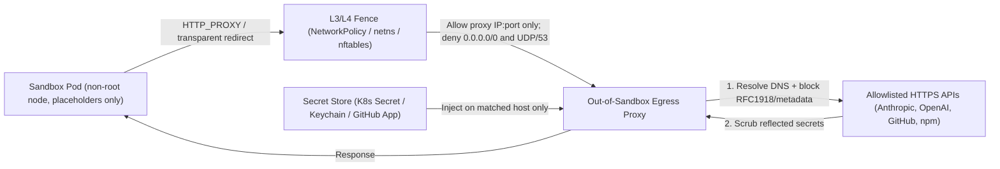

# Sandbox egress control and credential isolation

Research note, November 2026. Questions: how do public open-source agent
sandboxes enforce non-bypassable outbound network egress in containers and
Kubernetes, and how do they hide sensitive environment variables and API
credentials so the agent and arbitrary scripts cannot read or exfiltrate them
while authenticated tools still work?

The short answer: the industry converged in 2025-2026 on a two-layer boundary
sometimes called the **credential-injecting egress proxy** pattern. The
sandbox itself holds zero real secrets and has no direct route to the
internet or to internal cluster/metadata IPs. Inside the sandbox, programs
read opaque placeholder values from standard environment variables (such as
`ANTHROPIC_API_KEY` or `GITHUB_TOKEN`). Every outbound connection is forced
through an out-of-sandbox proxy that resolves DNS, rejects private and
metadata ranges, enforces domain/method/path allowlists, terminates TLS with
a sandbox-trusted CA, swaps placeholders for real credentials only on
authorized upstream hosts, and scrubs reflected secrets from responses.

## Core problem statement

Autonomous coding agents (`pi`, `codex`, `claude`, `opencode`) combine three
properties that Simon Willison and sandbox practitioners call the **lethal
trifecta**: untrusted inputs (repository code, PR comments, issue text, web
pages), arbitrary code execution (shell tools, test suites, build scripts),
and network egress. If real credentials live in the sandbox environment or
filesystem:

1. **Direct exfiltration:** Prompt injection or a compromised dependency can
   run `env`, read `~/.git-credentials`, and POST the values to an attacker
   host or encode them into DNS labels (`<hex>.attacker.example`).
2. **Lateral movement and SSRF:** Unconstrained pod egress lets sandbox code
   probe cluster services, the Kubernetes API, RFC 1918 subnets, or cloud
   instance metadata endpoints (`169.254.169.254`).
3. **Script compatibility:** Simply deleting environment variables breaks
   agent CLIs, SDKs, `git`, `curl`, and repository test scripts that expect
   standard variables (`OPENAI_API_KEY`, `ANTHROPIC_API_KEY`, `GITHUB_TOKEN`)
   to be present and non-empty.

## How secret-free sandboxes keep scripts working

Across primary open-source implementations (`NVIDIA/OpenShell`,
`jingkaihe/matchlock`, `earendil-works/gondolin`, `agentcage/agentcage`,
`github/gh-aw-firewall`, `dmno-dev/varlock`, `mikekelly/gap`, Deno Sandbox,
and Fly.io Sprites), the pattern relies on five coordinated mechanisms.

### 1. Placeholder (sentinel) substitution at the egress proxy

Real secrets never enter the sandbox's memory, `/proc/<pid>/environ`, or
filesystem. Instead:

- The sandbox receives a deterministic or random placeholder in the expected
  environment variable (for example `GONDOLIN_SECRET_<hex>`,
  `agentcage:secret:<KEY>:<hex>`, `openshell:resolve:env:MY_TOKEN`, or
  `DENO_SECRET_PLACEHOLDER_<id>`).
- Unmodified CLIs and scripts pass that placeholder in `Authorization`
  headers, query strings, or Git Smart-HTTP Basic auth as usual.
- The egress proxy terminates TLS using a per-cluster or per-sandbox CA,
  checks that the destination host (and optionally HTTP method, URL path, or
  calling binary) is authorized for that specific secret, and replaces the
  placeholder with the real credential on the wire.
- If the agent runs `printenv` or sends the placeholder to an allowlisted
  non-matching host (for example a package registry or webhook test server),
  the proxy does **not** substitute the secret, so only a useless sentinel
  leaves the sandbox.
- Mature proxies (`agentcage`, `varlock`) also scan inbound HTTP responses
  and redact any occurrence of real secret material (raw, base64,
  JSON-escaped, or URL-encoded) to block **response-reflection attacks**
  against echo endpoints on allowed domains.

### 2. Non-bypassable network enforcement

Setting `HTTP_PROXY` and `HTTPS_PROXY` alone is advisory; any script can
unset those variables or open a raw TCP/UDP socket. Production sandboxes
pair the proxy with a kernel-level fence the sandbox process cannot modify:

- **Kubernetes `NetworkPolicy` / CNI:** Default-deny egress from sandbox
  pods, permitting only the egress proxy's pod/IP and port (and denying
  RFC 1918, link-local `169.254.0.0/16`, cluster internal services, and
  arbitrary internet destinations).
- **Network namespace stripping + Unix socket bridge:** Used by
  `anthropics/sandbox-runtime` (`bubblewrap` unshares the network namespace
  so the sandbox has no external interface, while `socat` bridges a mounted
  Unix socket to a host-side HTTP/SOCKS5 proxy).
- **Host/container `iptables` or `nftables`:** Used by `github/gh-aw-firewall`
  (`DOCKER-USER` chain + container output rules) and `coder/httpjail` /
  `coder/boundary` to drop direct traffic or transparently redirect ports
  80/443 to the proxy.
- **MicroVM virtual NIC / host-side network stack:** Used by
  `jingkaihe/matchlock`, `earendil-works/gondolin`, Deno Sandbox, and Fly.io
  Sprites; the guest VM has no direct host networking and every packet exits
  through a host-controlled virtual stack.

### 3. Blocking DNS exfiltration and SSRF / DNS rebinding

Allowing raw UDP/TCP port 53 to arbitrary resolvers lets a sandbox encode
secrets in DNS queries (`<secret-chunk>.evil.example`) even when TCP 80/443
is blocked. Primary implementations close this gap in two ways:

1. **No direct DNS inside the sandbox:** Deny port 53 completely via
   `NetworkPolicy` or empty network namespace, and rely on HTTP `CONNECT`
   (or SOCKS5h) where the **proxy** resolves hostnames only after checking
   the domain allowlist.
2. **Allowlisting DNS proxy:** When non-proxy-aware tools must resolve names
   (for example transparent proxies or `CiliumNetworkPolicy` `toFQDNs`),
   restrict port 53 strictly to a filtering resolver (Cilium's node-local
   DNS proxy, CoreDNS + policy, or a `dnsmasq` sidecar as in `agentcage`)
   that rejects queries for non-allowlisted domains.

After DNS resolution, the egress proxy must validate the resolved IP address
at dial time — not just the hostname — and reject private, loopback,
link-local, and cloud metadata IPs (`10.0.0.0/8`, `172.16.0.0/12`,
`192.168.0.0/16`, `169.254.0.0/16`, `127.0.0.0/8`, `fc00::/7`, `fe80::/10`)
to defeat DNS rebinding (`stripe/smokescreen` pattern).

### 4. Handling non-proxy-aware scripts, TLS trust, and Git

- **Proxy-unaware programs:** Scripts or compiled binaries that ignore
  `HTTP_PROXY`/`HTTPS_PROXY` either fail closed (when direct egress is
  dropped) or require transparent interception (`iptables`/`nftables`
  REDIRECT/TPROXY via a privileged `initContainer` that drops `NET_ADMIN`
  before the agent starts, or a microVM virtual NIC).
- **CA trust plumbing:** Because TLS MITM requires the sandbox to trust the
  proxy's CA, sandboxes install the CA certificate into the OS bundle
  (`/etc/ssl/certs` via `update-ca-certificates`) **and** set runtime-specific
  environment variables for ecosystems that bypass the OS store:
  `NODE_EXTRA_CA_CERTS` (Node.js — critical for `pi`, `codex`, `claude`,
  `opencode`), `SSL_CERT_FILE` (OpenSSL/Go/Rust), `REQUESTS_CA_BUNDLE`
  (Python `requests`), `CURL_CA_BUNDLE`, and `GIT_SSL_CAINFO`. The CA file
  and trust store must remain read-only to the non-root agent user.
- **Certificate pinning:** Binaries that hardcode upstream public-key pins
  reject MITM certificates; proxies typically provide a TLS-passthrough
  (SNI-only) allowlist mode for pinned endpoints that do not require secret
  injection.
- **Git and GitHub credentials:** Rather than injecting a long-lived Personal
  Access Token (PAT) or forwarding an SSH agent (`SSH_AUTH_SOCK` lets any
  process sign arbitrary commits or access every repo the key unlocks),
  modern agent setups route `git` over HTTPS through the egress proxy and
  have the proxy mint short-lived (1-hour), repository-scoped **GitHub App
  installation tokens** on demand, injecting them into Smart-HTTP
  `Authorization` headers only for authorized `github.com/<owner>/<repo>`
  paths.

### 5. What an HTTP egress proxy cannot hide

Honest threat modeling requires naming the boundaries where placeholder
substitution stops working:

- **Local-only cryptographic material:** Signing keys (SSH/GPG private keys
  used for local commit signing, TLS server keys, JWT/cookie signing secrets,
  local encryption keys) are consumed inside the sandbox process itself and
  never traverse an outbound HTTP request. They must be moved behind a narrow
  out-of-sandbox signing/RPC daemon or omitted from the sandbox entirely.
- **Non-HTTP wire protocols:** Direct PostgreSQL, MySQL, Redis, raw TCP,
  SMTP, or SSH connections cannot be inspected or rewritten by an HTTP
  proxy. Hiding database or SSH credentials requires dedicated L4/protocol
  proxies (for example a database proxy or SSH certificate bastion) outside
  the sandbox.
- **Client-signed HTTP requests (HMAC / AWS SigV4):** When the client
  computes an HMAC signature over the request headers and body using the
  secret key before sending, a simple string swap breaks the signature. The
  proxy must either re-sign requests on the wire (as `anthropics/sandbox-runtime`
  supports for SigV4) or broker access through a higher-level endpoint.
- **Confused-deputy capability abuse:** Even if a prompt-injected agent
  never learns the raw `GITHUB_TOKEN` bytes, it can still use the proxy to
  perform any API action the token permits (pushing malicious code, leaking
  repo contents into a public issue comment). Proxy-side secret hiding must
  therefore be paired with least-privilege scoping (single-repo GitHub App
  tokens), HTTP method/path restrictions (for example denying force-push or
  admin endpoints), and short token lifetimes.

## Comparison of verified public repositories

| Repository | Language | License | Network egress enforcement | Env-var / secret protection | Kubernetes fit | Key limitations |
| --- | --- | --- | --- | --- | --- | --- |
| [NVIDIA/OpenShell](https://github.com/NVIDIA/OpenShell) | Rust core; Go, TS, Python, Rust SDKs | Apache-2.0 | Default-deny pod fence; supervisor L7/CONNECT proxy; per-binary, host, port, and HTTP method rules | Placeholder tokens (`openshell:resolve:env:*`) swapped by gateway/supervisor proxy from credential store | High — builds directly on `kubernetes-sigs/agent-sandbox` (`agents.x-k8s.io`) pods and `NetworkPolicy` | Heavyweight platform (moving to CNCF as `ai-openshell`); adds its own gateway/supervisor control plane |
| [github/gh-aw-firewall](https://github.com/github/gh-aw-firewall) | TypeScript, Go, Squid | MIT | Default-deny Docker network + `iptables` (`DOCKER-USER` & container rules) + Squid with optional SSL Bump for URL path filtering | Dedicated Go API proxy sidecar holds LLM keys; strips raw tokens from agent env; supports placeholders / one-shot tokens | Medium — architecture maps cleanly to K8s sidecar + `NetworkPolicy`, though CLI targets Docker / GitHub Actions | Docker-centric packaging; Squid SSL Bump adds operational complexity |
| [anthropics/sandbox-runtime](https://github.com/anthropics/sandbox-runtime) | TypeScript (`bwrap`, `socat`, seccomp) | Apache-2.0 | Default-deny `allowedDomains`/`deniedDomains`; strips Linux netns (`bwrap`) and bridges via Unix socket + `socat` to host HTTP/SOCKS5 proxy; seccomp blocks `AF_UNIX` | Protects credential files via FS policy; supports proxy-side header injection and AWS SigV4 credential rewriting | Low — designed for host-local process sandboxing without containers (`bwrap` requires user namespaces often disabled in pods) | Not a Kubernetes control plane; macOS Seatbelt / Linux `bwrap` focus |
| [jingkaihe/matchlock](https://github.com/jingkaihe/matchlock) | Go | MIT | Firecracker / Virtualization.framework microVM; default-deny `--allow-host`; `iptables`/`nftables` + host DNS handling | Host MITM proxy with custom CA swaps guest placeholders (`--secret-placeholder`) for real keys in-flight on matched hosts | Low-Medium — requires KVM/nested virt in K8s, but its Go MITM placeholder proxy design is directly reusable | MicroVM runtime rather than standard K8s container pods |
| [earendil-works/gondolin](https://github.com/earendil-works/gondolin) | TypeScript | Apache-2.0 | QEMU / `libkrun` Linux microVM; programmable host-side HTTP hooks (`allowedHosts`) | `createHttpHooks` exposes placeholders in guest `env` and injects real values only for configured `hosts` | Low — embedded Node/TS microVM SDK, not Kubernetes-native | Experimental; requires QEMU/`libkrun` rather than OCI pods |
| [agentcage/agentcage](https://github.com/agentcage/agentcage) | Python CLI, Rust proxy | MIT | Internal-only container/VM network (Podman, Apple Container, Lima); `dnsmasq` DNS filter + Rust TLS-inspecting proxy | Self-identifying placeholders (`agentcage:secret:KEY:<hex>`) swapped outbound and redacted inbound (raw, base64, JSON, URL-encoded) | Medium — Rust proxy + DNS-filtering pattern translates well to K8s, though CLI targets Podman/VMs | Designed for local rootless Podman/VM cages rather than K8s CRDs |
| [coder/httpjail](https://github.com/coder/httpjail) & [coder/boundary](https://github.com/coder/boundary) | Rust (`httpjail`); Go (`boundary`) | CC0-1.0 (`httpjail`); MIT (`boundary`) | Process-level netns (`nsjail`/Linux namespaces) + transparent TLS-intercepting proxy; V8 JS rules (`httpjail`) or method/path allowlists (`boundary`) | Keeps credentials outside sandboxed process; boundary/agent-firewall pattern pairs with proxy-side header injection | Low-Medium — process-level wrappers for inside a workspace/VM; Go `boundary` code is clean reference for K8s sidecars | Primarily single-process/workspace wrappers, not cluster-wide K8s controllers |
| [mikekelly/gap](https://github.com/mikekelly/gap) | Rust core, Go management, JS/TS transforms | MIT | Local HTTP/HTTPS proxy bound to loopback; plugin/host matching and request auditing | Issues opaque Gap tokens to agents; loads real secrets from OS keychain/service store and injects via JS/TS transforms | Medium — works as a credential-injection sidecar/service if paired with K8s `NetworkPolicy` | Does not enforce L3/L4 network isolation itself; must be paired with a network fence |
| [dmno-dev/varlock](https://github.com/dmno-dev/varlock) | TypeScript (standalone CLI) | MIT | `varlock proxy` outbound credential broker (also used in Fly.io broker-sprite topology) | `.env.schema` hides real values from agents; proxy exposes placeholders locally, injects real values at network boundary, scrubs responses | Medium — broker-pod pattern works in K8s alongside `NetworkPolicy` | Focused on `.env` schema + credential brokering rather than L3/L4 firewalling |
| [stripe/smokescreen](https://github.com/stripe/smokescreen) | Go | MIT | HTTP `CONNECT` egress proxy; YAML domain ACLs (`open`/`report`/`enforce`); resolves DNS and blocks private/loopback/metadata IPs | None (no TLS MITM or secret injection — pure `CONNECT` SSRF/egress guard) | High — battle-tested stateless Go Deployment behind a ClusterIP Service + `NetworkPolicy` | No L7 path filtering or credential injection out of the box (ideal SSRF/dialer base layer) |
| [agentgateway/agentgateway](https://github.com/agentgateway/agentgateway) | Rust | Apache-2.0 | Linux Foundation agentic proxy for LLM APIs, MCP servers, and external tools with routing and L7 policy | Upstream authentication and credential wrapping so agent runtimes call LLM/MCP endpoints without raw API keys | High — cloud-native Kubernetes gateway for LLM and MCP egress | Focused on LLM/MCP gatewaying rather than arbitrary `curl`/`git`/package-registry MITM proxying |
| [cilium/cilium](https://github.com/cilium/cilium) | Go, C (eBPF), Envoy | Apache-2.0 (BPF dual GPLv2/BSD-2) | eBPF CNI + node-local DNS proxy (`toFQDNs`) + transparent Envoy L7 HTTP method/path/header enforcement | Envoy SDS / `CiliumEnvoyConfig` can inject Kubernetes Secret headers at L7 without mounting secrets in agent pods | Very High — native Kubernetes CNI and observability (Hubble) | Requires replacing `kindnet` (`disableDefaultCNI: true`); header injection via Envoy is static rather than placeholder-swapping unless extended |
| [kubernetes-sigs/agent-sandbox](https://github.com/kubernetes-sigs/agent-sandbox) | Go | Apache-2.0 | Reconciles per-`SandboxTemplate` Kubernetes `NetworkPolicy` (`networkPolicyManagement: Managed`) | `envVarsInjectionPolicy` controls claim-time env overrides; no built-in credential proxy | Native — this is Nightshift's existing controller | Managed default `NetworkPolicy` allows `0.0.0.0/0` minus RFC 1918 and `169.254.0.0/16` (no FQDN filtering or secret isolation) |

Notable foundational proxy building blocks (frequently embedded inside the
projects above): [envoyproxy/envoy](https://github.com/envoyproxy/envoy)
(C++, Apache-2.0), [mitmproxy/mitmproxy](https://github.com/mitmproxy/mitmproxy)
(Python/Rust, MIT), and [squid-cache/squid](https://github.com/squid-cache/squid)
(C++, GPL-2.0). Notable managed cloud reference designs using the same
placeholder-swap architecture: **Deno Sandbox** (`@deno/sandbox`, `allowNet`
plus per-host `secrets` placeholder substitution at the microVM boundary)
and **Fly.io Sprites** (Sprite Connectors gateway and self-hosted Varlock
broker-sprite pattern).

## Deep dives on the strongest patterns

### 1. Kubernetes-native stacks: `agent-sandbox`, `NVIDIA/OpenShell`, and `Cilium`

- **`kubernetes-sigs/agent-sandbox`** (Nightshift's controller) already
  includes `spec.networkPolicyManagement` (`Managed` by default, or
  `Unmanaged`), `spec.networkPolicy`, and `spec.envVarsInjectionPolicy`
  (`Disallowed` by default, or `Allowed`/`Overrides`) on `SandboxTemplate`
  (`extensions.agents.x-k8s.io/v1beta1`). In `Managed` mode without custom
  rules, the controller generates a `NetworkPolicy` per template that blocks
  RFC 1918 (`10.0.0.0/8`, `172.16.0.0/12`, `192.168.0.0/16`), link-local /
  cloud metadata (`169.254.0.0/16`), and private IPv6 ranges (`fc00::/7`,
  `fe80::/10`), while still permitting unrestricted public internet egress.
  Supplying a custom `spec.networkPolicy` overrides that default so egress
  can be pinned strictly to an egress proxy service.
- **`NVIDIA/OpenShell`** is the closest open-source reference architecture
  built directly atop `kubernetes-sigs/agent-sandbox`. Its Rust supervisor
  and gateway sit outside the sandbox boundary, intercept TCP and DNS
  traffic, enforce default-deny egress with per-binary and L7 HTTP method
  rules, and resolve placeholder tokens (`openshell:resolve:env:<NAME>`)
  from an out-of-sandbox credential store only when policy matches. Its
  trade-off is footprint: adopting all of OpenShell pulls in its full
  supervisor/gateway stack rather than a thin Go service.
- **`cilium/cilium`** solves the Kubernetes L3/L4 gap at the CNI layer.
  Standard `NetworkPolicy` cannot filter by domain name or inspect DNS
  queries. Cilium's `CiliumNetworkPolicy` intercepts port 53 traffic in a
  node-local DNS proxy, enforces `rules.dns` allowlists (blocking DNS
  tunneling to arbitrary domains), dynamically programs eBPF maps for
  `toFQDNs`, and hands L7 HTTP rules to Envoy with Hubble telemetry.

### 2. Container firewall + API proxy sidecar: `github/gh-aw-firewall` and `agentcage`

- **`github/gh-aw-firewall`** (GitHub Next's Agentic Workflow Firewall, AWF)
  powers egress control for GitHub Agentic Workflows and mirrors GitHub
  Copilot coding agent's firewall design. It combines host and container
  `iptables` rules (default-deny), a Squid proxy with optional SSL Bump for
  HTTPS domain/path filtering, and an always-on **Go API proxy sidecar**
  that holds LLM provider keys (`ANTHROPIC_API_KEY`, OpenAI, Copilot,
  Gemini) outside the agent container. This cleanly separates two concerns:
  arbitrary web/registry traffic goes through the domain-allowlisting proxy,
  while LLM API traffic goes through a dedicated reverse proxy that appends
  provider credentials without needing MITM on every HTTPS connection.
- **`agentcage/agentcage`** demonstrates defense-in-depth for general
  coding agents (explicitly targeting Claude Code, Codex, and Pi). Its
  container runs on an internal-only network with no default gateway,
  forcing all traffic through a `dnsmasq` DNS filter and a custom Rust
  TLS-inspecting proxy. Its strongest credential detail is **bidirectional
  protection**: self-identifying placeholders (`agentcage:secret:KEY:<hex>`)
  are swapped outbound only for configured hosts, and inbound response
  bodies/headers are scanned and redacted across raw, base64, JSON-escaped,
  and percent-encoded forms.

### 3. Go and TypeScript MITM placeholder proxies: `matchlock`, `gondolin`, `smokescreen`, `coder/boundary`

- **`jingkaihe/matchlock`** (Go, MIT) is an especially clear blueprint for a
  Go codebase like Nightshift. Even though Matchlock uses microVMs for
  compute isolation, its proxy design — a Go TLS-intercepting proxy with a
  generated CA, `--allow-host` enforcement, and `--secret-placeholder`
  substitution scoped per host — maps almost 1:1 to a standalone Go proxy
  pod in Kubernetes.
- **`earendil-works/gondolin`** (TypeScript, Apache-2.0) and **Deno
  Sandbox** popularized the minimal declarative API for secret isolation:
  bind each secret env var to an explicit list of `hosts` so the proxy
  refuses to inject it anywhere else.
- **`stripe/smokescreen`** (Go, MIT) provides the gold-standard Go
  implementation for SSRF-safe egress dialing: custom `net.Dialer` checks
  that resolve DNS and reject every private, loopback, multicast, and
  link-local/metadata IP before opening the upstream socket, preventing DNS
  rebinding attacks that naive Go `http.Transport` proxies miss.
- **`coder/httpjail`** (Rust, CC0-1.0) and **`coder/boundary`** (Go, MIT)
  show how to enforce transparent, non-bypassable HTTP/HTTPS interception
  and method/path rules for processes that do not honor `HTTP_PROXY`.

### 4. Dedicated credential brokers: `mikekelly/gap` and `dmno-dev/varlock`

- **`mikekelly/gap`** (Rust/Go/TS, MIT) and **`dmno-dev/varlock`** (TS,
  MIT) focus exclusively on credential brokering rather than container
  firewalls. They are useful if you want pluggable auth transforms or
  schema-driven `.env` management (`.env.schema` lets agents see variable
  names, types, and descriptions without reading values), provided you still
  enforce an L3/L4 fence around the sandbox pod.

## Practical recommendation for Nightshift

Inspection of Nightshift's live cluster (`kind-agent-sandbox`,
Kubernetes `v1.34.0`) and manifests (`k8s/warmpool.yaml`,
`images/base/Dockerfile`) establishes three concrete facts:

1. **L3/L4 `NetworkPolicy` already works on `kind-agent-sandbox`:** The
   cluster runs `docker.io/kindest/kindnetd:v20250512-df8de77b`. Starting
   with `kind` v0.24.0+, `kindnetd` embeds SIG Network's
   `kube-network-policies` (first-packet `nftables` interception with
   conntrack caching), so standard `NetworkPolicy` egress rules are
   enforced without replacing the CNI first.
2. **`agent-sandbox` already generates per-template policies:** The
   controller creates `pi-template-network-policy`,
   `codex-template-network-policy`, `claude-code-template-network-policy`,
   and `opencode-template-network-policy` in `nightshift`. Today their
   default egress rule blocks RFC 1918 and `169.254.0.0/16` but allows all
   other `0.0.0.0/0` traffic and arbitrary DNS.
3. **Nightshift sandboxes are non-root Debian Node 24 containers:**
   `images/base/Dockerfile` runs as `USER node` on `node:24-trixie-slim`
   with `ca-certificates`, `curl`, `git`, `python3`, and `openssh-client` —
   so baking or mounting a read-only proxy CA certificate and setting
   runtime CA variables works cleanly across `pi`, `codex`, `claude`,
   `opencode`, `git`, `curl`, and `python3`.

### Recommended phased architecture

#### Phase 1 — Default-deny `NetworkPolicy` + Go credential-injecting egress proxy (works on current `kindnetd`)

1. **Deploy a thin Go egress proxy in a separate namespace** (for example
   `nightshift-egress`, never `nightshift`) so sandbox pods and their
   service accounts have zero RBAC or volume access to real Kubernetes
   Secrets.
2. **Split LLM/API injection from general HTTPS allowlisting (or combine
   them in one Go binary):**
   - **Option A (no MITM required for LLM APIs, lowest friction):** Run a
     dedicated reverse-proxy listener (like `github/gh-aw-firewall`'s Go API
     proxy) for `ANTHROPIC_BASE_URL`, `OPENAI_BASE_URL`, etc., where the
     sandbox holds a dummy key (`sk-nightshift-placeholder`) and the proxy
     replaces `Authorization` / `x-api-key` headers upstream. Pair it with a
     forward `HTTP CONNECT` allowlist proxy (built with `stripe/smokescreen`
     SSRF-safe dialing) for registries (`registry.npmjs.org`, `proxy.golang.org`,
     `pypi.org`) and `github.com`.
   - **Option B (full placeholder swap for arbitrary scripts and `git`):**
     Add TLS MITM interception (modeled on `jingkaihe/matchlock` and
     `agentcage`) with a generated cluster CA mounted read-only into sandbox
     pods and wired via `NODE_EXTRA_CA_CERTS`, `SSL_CERT_FILE`,
     `REQUESTS_CA_BUNDLE`, `CURL_CA_BUNDLE`, and `GIT_SSL_CAINFO`. Bind each
     placeholder env var (`ANTHROPIC_API_KEY`, `OPENAI_API_KEY`,
     `GITHUB_TOKEN`) to explicit host+path rules, mint 1-hour repo-scoped
     GitHub App installation tokens for `git` Smart-HTTP, and scrub real
     secret values from inbound responses.
3. **Lock down `SandboxTemplate.spec.networkPolicy`** in `k8s/warmpool.yaml`
   (and for checkout `Sandbox` pods created by Nightshift) so egress is
   permitted **only** to the proxy pod IP/port in `nightshift-egress`:
   - Drop all direct internet traffic (`0.0.0.0/0`), RFC 1918, metadata
     (`169.254.169.254`), and direct UDP/TCP port 53.
   - Set `HTTP_PROXY`, `HTTPS_PROXY`, and `NO_PROXY=localhost,127.0.0.1` in
     the template so tools resolve DNS through the proxy (eliminating DNS
     exfiltration completely on `kindnetd`).
   - Keep `automountServiceAccountToken: false` on sandbox pods so scripts
     cannot read a Kubernetes API token from `/var/run/secrets`.

#### Phase 2 — Transparent capture and CNI upgrade for proxy-unaware scripts

- When workflows run scripts or compiled tools that ignore `HTTP_PROXY` or
  require direct DNS lookups, recreate `kind-agent-sandbox` with
  `disableDefaultCNI: true` and install **Cilium** (`cilium/cilium`). Use
  `CiliumNetworkPolicy` with `rules.dns` + `toFQDNs` to block DNS
  exfiltration while gaining Hubble flow logs for every sandbox pod.
- Alternatively (or additionally), add a lightweight `initContainer` with
  `CAP_NET_ADMIN` that installs `nftables` rules redirecting TCP 80/443 from
  UID `node` to a transparent proxy sidecar, then exits so the `agent`
  container runs unprivileged with zero capabilities.

#### Phase 3 — Per-claim scoping and stronger runtime isolation

- Issue a unique per-`SandboxClaim` proxy identity (via proxy auth token or
  pod-IP-to-Sandbox lookup from the Kubernetes API) so each PR/issue
  sandbox's GitHub App token and allowlist are scoped strictly to that
  single repository and branch — aligning with Nightshift's existing
  per-PR/issue volume model.
- Pair egress controls with kernel-level sandbox runtime isolation
  (`runtimeClassName: gvisor` or Kata Containers) and a read-only root
  filesystem (writable `~/workspace` and `/tmp` only) so a compromised agent
  cannot tamper with CA bundles or system binaries.

## Primary sources

- Kubernetes SIG Apps. `kubernetes-sigs/agent-sandbox` (Apache-2.0, Go):
  [GitHub repository](https://github.com/kubernetes-sigs/agent-sandbox).
- NVIDIA. `NVIDIA/OpenShell` (Apache-2.0, Rust/Go/TS/Python):
  [GitHub repository](https://github.com/NVIDIA/OpenShell).
- GitHub Next. `github/gh-aw-firewall` — Agentic Workflow Firewall (MIT,
  TypeScript/Go/Squid):
  [GitHub repository](https://github.com/github/gh-aw-firewall).
- GitHub Docs. "Customizing or disabling the firewall for Copilot coding
  agent":
  [official documentation](https://docs.github.com/en/copilot/how-tos/agents/copilot-coding-agent/customizing-the-agent-firewall).
- Anthropic. `anthropics/sandbox-runtime` (`srt`, Apache-2.0, TypeScript):
  [GitHub repository](https://github.com/anthropics/sandbox-runtime).
- Jingkai He. `jingkaihe/matchlock` (MIT, Go):
  [GitHub repository](https://github.com/jingkaihe/matchlock).
- Earendil Works. `earendil-works/gondolin` (Apache-2.0, TypeScript):
  [GitHub repository](https://github.com/earendil-works/gondolin).
- Agentcage. `agentcage/agentcage` (MIT, Python/Rust):
  [GitHub repository](https://github.com/agentcage/agentcage).
- Coder. `coder/httpjail` (CC0-1.0, Rust) and `coder/boundary` (MIT, Go):
  [httpjail repository](https://github.com/coder/httpjail) and
  [boundary repository](https://github.com/coder/boundary).
- Mike Kelly. `mikekelly/gap` — Gated Agent Proxy (MIT, Rust/Go/TS):
  [GitHub repository](https://github.com/mikekelly/gap).
- DMNO. `dmno-dev/varlock` (MIT, TypeScript):
  [GitHub repository](https://github.com/dmno-dev/varlock).
- Stripe. `stripe/smokescreen` (MIT, Go):
  [GitHub repository](https://github.com/stripe/smokescreen).
- Linux Foundation / Agentgateway. `agentgateway/agentgateway` (Apache-2.0,
  Rust):
  [GitHub repository](https://github.com/agentgateway/agentgateway).
- Cilium. `cilium/cilium` (Apache-2.0, Go/C eBPF) and DNS/FQDN policy docs:
  [GitHub repository](https://github.com/cilium/cilium) and
  [DNS-based policy documentation](https://docs.cilium.io/en/stable/security/dns/).
- Kubernetes SIGs. `kubernetes-sigs/kind` (kindnetd + `kube-network-policies`
  support since v0.24.0):
  [kind repository](https://github.com/kubernetes-sigs/kind) and
  [kube-network-policies repository](https://github.com/kubernetes-sigs/kube-network-policies).
- Deno. Deno Sandbox documentation (egress allowlists and secret
  substitution):
  [official documentation](https://docs.deno.com/sandbox/).
- Fly.io. Sprites documentation (isolated microVMs and credential gateways):
  [official documentation](https://sprites.dev/).
- Foundational proxy repositories:
  [envoyproxy/envoy](https://github.com/envoyproxy/envoy) (Apache-2.0),
  [mitmproxy/mitmproxy](https://github.com/mitmproxy/mitmproxy) (MIT), and
  [squid-cache/squid](https://github.com/squid-cache/squid) (GPL-2.0).
